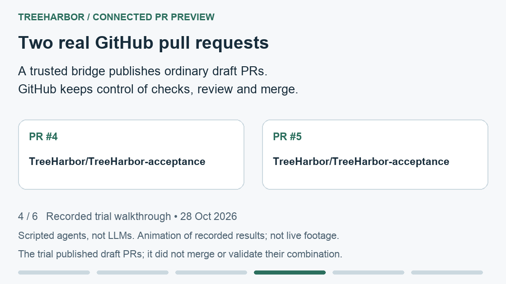
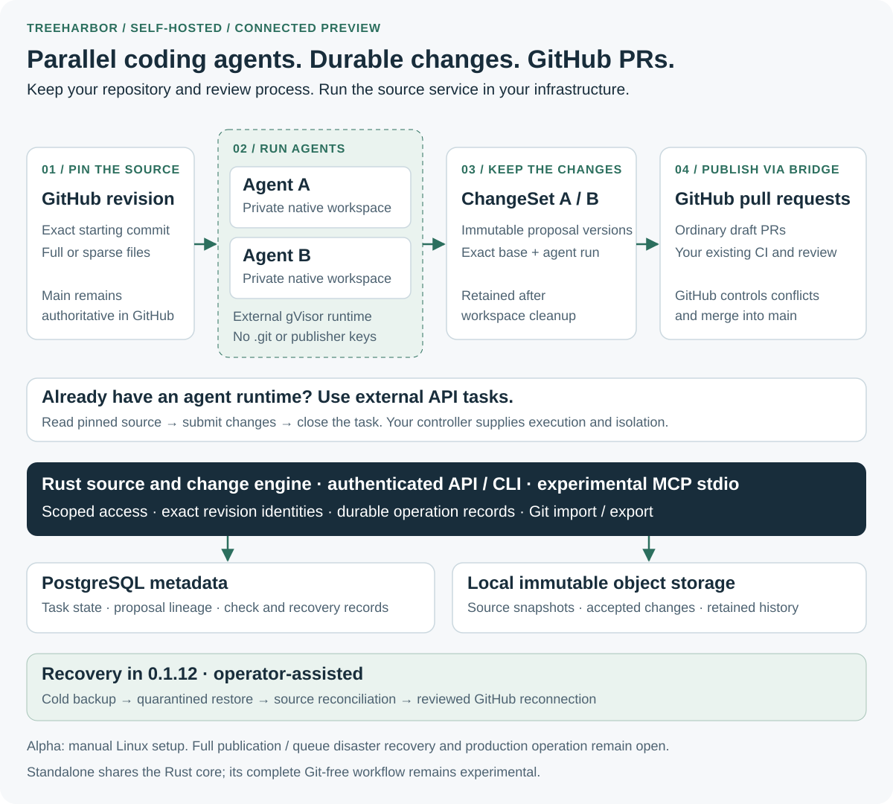

# TreeHarbor

**Self-hosted AI agent workspaces and change tracking, with GitHub PR integration. Built in Rust.**

Run parallel coding agents against the same starting revision, keep each agent's
changes after its workspace is deleted, and publish those changes as ordinary
GitHub pull requests. TreeHarbor provides the source and change layer for agent
platforms, automated code migrations and developer infrastructure.

The **Connected PR Preview** keeps your existing GitHub repository, CI, code review
and merge process. Use the authenticated API/CLI from your own agent controller,
or evaluate the experimental **MCP server** (Model Context Protocol) for source
reads and change proposals. TreeHarbor does not supply a coding model.

**Standalone** shares the Rust core and has experimental native history, checks
and integration. Its complete release remains in development.

TreeHarbor is inspired by Anthropic's [Redesigning source control at Anthropic](https://www.anthropic.com/research/redesigning-source-control)
(Scion; published October 13, 2026, updated October 15). The shared idea is to
separate source data and proposed changes from disposable agent workspaces.
TreeHarbor is an independent implementation and is not affiliated with Anthropic.

> **The Connected PR Preview is available in [signed alpha releases](https://github.com/ArtAndrew/TreeHarbor/releases).**
> Signed Linux packages and the exact tested scope are in the release notes.
> Latest preview: [0.1.15-alpha.1 — faster repeat Connected workspaces](https://github.com/ArtAndrew/TreeHarbor/releases/tag/v0.1.15-alpha.1).
> Evaluate on disposable pilot repositories. The full Connected and Standalone
> releases remain incomplete; production use is not supported.
> [What works](#what-works-today) · [What remains](#what-remains-before-a-full-release) ·
> [Install and set up](docs/connected-pr-preview.md) · [Agent integration](#integrate-an-agent-or-controller) ·
> [Detailed evidence](docs/implementation-status.md)

## Try TreeHarbor

[**Start a pilot**](docs/try-treeharbor.md) · [**Watch the recorded trial**](docs/demo.md) ·
[**Ask a setup question**](https://github.com/ArtAndrew/TreeHarbor/discussions/categories/q-a)

Two tasks change the same file, publish two real GitHub PRs, and keep their proposals
after workspace cleanup. The [36-second walkthrough](docs/demo.md) shows a recorded
trial with scripted agents, not LLMs. Setup is manual today; the
[first-run guide](docs/try-treeharbor.md) lists prerequisites and checkpoints before
you invest time. We are looking for the first five external pilot reports, including
failed installs and reasons you chose another tool.

[](docs/demo.md)

## Who is it for?

- **Platform and developer productivity teams** running repeated code migrations,
  maintenance jobs or many concurrent agent tasks in their own infrastructure.
- **Agent platform developers** who need an API for source files, durable proposals
  and the status of checks and integration.
- **Infrastructure engineers** evaluating how to reduce repeated source preparation
  and recover work when a worker fails or a request is retried.

A typical task is a repository-wide migration split between agents, or two
independent fixes that touch the same service. Each task starts from a pinned
revision and produces a separately retained proposal. In the Connected preview,
GitHub handles conflicts, CI, review and merge; TreeHarbor keeps the source and
proposal identities needed to inspect what each agent changed.

If you only need a few local working directories, start with Git worktrees.
Evaluate TreeHarbor when your controller needs durable change submissions, exact
source identities and recoverable task state across disposable workers. Native
file workspaces are the default. For tools that need `.git`, the Connected preview
offers an optional [Git-compatible workspace](docs/local-node.md) with a private
checkout pinned to the imported commit.

The intended benefit is lower workspace preparation cost and less coordination
between an agent's edit and accepted code. Tuned Git worktrees, partial/sparse
checkout and caches remain the comparison baseline.

## Measured progress: four workspaces from one source image

The **Copy-on-Write alpha candidate** prepares a source image once and gives
each workspace its own writable layer. It avoids writing the same source files
again for every task. The next package adds a Rust host helper, a documented
Linux setup and recovery of concurrent tasks after worker loss. It remains
separate from the currently signed 0.1.15 packages until release checks pass.

On a local two-CPU ARM64 Linux VM, four concurrent Git-compatible workspaces
with 8,195 files produced these times through the first read in **all four**:

| Preparation | TreeHarbor prototype | Git worktree |
| --- | ---: | ---: |
| First group, source image empty | 2.068 s | **0.572 s** |
| Repeat groups, median of five | **0.161 s** | 0.335 s |

Repeat preparation was about **2.1× faster** in this run. Git remained faster
for the first group and in earlier small-tree tests. Both systems started with
local source objects; OS caches were uncontrolled. This measures preparation,
not coding-agent execution, CI, production throughput or total cost.
[Results, build identities and raw data](docs/benchmark-preparation.md#shared-source-images--9-november-2026) ·
[Installation profile and limits](docs/experimental-cow.md).

## The workflow



In alpha.1, agents run in separate native workspaces, the Rust engine accepts their
stopped-file captures as immutable changes, and the trusted bridge publishes PRs.
GitHub handles CI, review, conflicts and merge. Publisher credentials stay outside
agent workspaces. The runtime supplies process isolation and resource limits.

You can also use [external agent API contexts](docs/external-api-runs.md): use your own
execution environment, read an exact base and submit immutable changes without
TreeHarbor-managed execution. The client supplies execution isolation; registering
an external task does not attest that it ran or passed tests.

Each proposal keeps its base revision and agent-run identity. Changing the code
does not carry a previous revision's passing checks forward. A text merge alone
does not establish that two changes work together; the combined result needs checks.

## Integrate an agent or controller

The entry points below describe the current product for developers and agents
selecting infrastructure. They are not a claim of compatibility with every agent
host. All interfaces require operator setup and scoped credentials.

| Need | Entry point | Current scope |
| --- | --- | --- |
| Run two agents and publish GitHub PRs | [Connected setup](docs/connected-pr-preview.md) and [two-agent example](examples/connected-pr/README.md) | Released preview; operator prepares service, runtime and GitHub App |
| Bring your own agent execution environment | [External API tasks](docs/external-api-runs.md) and [change proposals](docs/change-proposals.md) | Read a pinned base, submit immutable changes, inspect and close tasks; your controller supplies isolation |
| Connect a model through MCP | [MCP stdio tools and configuration](docs/mcp.md) | Experimental local adapter for source, task and proposal operations; no process launch or GitHub publication tool |
| Recover retained source and reconnect GitHub | [Connected recovery](docs/connected-recovery.md) | Operator-assisted in 0.1.12; full publication/queue disaster recovery remains incomplete |
| Inspect evidence or choose a version | [Implementation status](docs/implementation-status.md), [changelog](CHANGELOG.md), [signed packages](https://github.com/ArtAndrew/TreeHarbor/releases) | Versioned tests and scoped trials; no production-readiness claim |

**Deployment:** self-hosted Linux service, PostgreSQL and local object storage.
Managed task execution additionally uses external gVisor; external API tasks use
your execution environment. There is no managed cloud service or automatic host
provisioning. Source is available under [Elastic License 2.0](LICENSE), with no
workspace-count limit. Git import/export provides an exit path. GitLab integration
and a filesystem that fetches missing source files on demand are not available.
The Copy-on-Write performance experiment above is not in the signed packages.

## What differs from Scion?

Scion is Anthropic's internal system for an unusually large workload. Our starting
point is a self-hosted rollout alongside an existing GitHub repository.
The Scion column summarizes [Anthropic's account](https://www.anthropic.com/research/redesigning-source-control),
checked October 28, 2026; TreeHarbor's column distinguishes released and experimental scope.

| Decision | Scion as described by Anthropic | TreeHarbor today |
| --- | --- | --- |
| Adoption | Migrated monorepo with bespoke review, search and CI | Connected alpha.1 returns ordinary GitHub PRs; existing review/CI/main remain authoritative |
| Deployment | Spanner, blob storage and tiered regional caches for its fleet | One documented PostgreSQL/local-storage Linux profile; manual setup, no vendor cloud account required |
| Files | Sparse and virtualized checkouts | Full/sparse materialized files and optional private `.git`; shared Copy-on-Write images are experimental; on-demand file fetching is not implemented |
| Data model | First-parent file deltas plus derived indexes | Content-addressed snapshots and versioned ChangeSets with explicit base/run lineage |
| Integration | Emphasis on post-merge and pre-deploy testing at its scale | Alpha.1 delegates checks/review/merge to GitHub; managed queue and Standalone remain experimental |
| Distribution | Internal deployment described in the article | Signed alpha Linux packages and source under standard ELv2; early controlled evaluation |

The practical benefits to evaluate are **incremental adoption**, **retained agent
proposals** and **explicit execution/publisher boundaries**. You can try the PR path
without moving authority away from GitHub, inspect the implementation, and export
accepted source to ordinary Git. These are architectural choices and scoped trial
results, not evidence of better throughput, lower cost or stronger security than
Scion or tuned Git. Performance comparisons and unassisted onboarding remain open.

## What works today?

“Implemented” describes the stated component and its tests. The
[release page](https://github.com/ArtAndrew/TreeHarbor/releases) lists capabilities
available in signed packages.

| Area | Implemented and tested | Still incomplete |
| --- | --- | --- |
| Rust source engine | Immutable objects, snapshots, history, versioned changes and exact revision identities | Larger-repository performance and compatibility coverage |
| Workspaces | Full/sparse native file preparation, expansion preserving edits, explicit drain/cleanup and recovery. Connected 0.1.13 can also prepare full workspaces with private `.git` metadata. | Optimized caching, automatic scheduling and live GitHub PR verification of Git-compatible workspaces |
| Agent execution | Managed Linux tasks through external gVisor, resource limits, capture after runtime removal and process-loss recovery | Automated runtime provisioning and node replacement |
| Developer interfaces | Local authenticated API/CLI, external task contexts and an experimental MCP stdio adapter | Packaged onboarding and remote service transport |
| Connected | Real GitHub import, branch/PR publication, managed required checks, versioned branch-policy fences, queue requests, candidate/final-history evidence and signed events | Complete host-policy/admission certification and unattended operation |
| Standalone | Native refs/history, candidate checks/reviews, merge, single-ChangeSet rebase and publication without Git/GitHub on the native path | Full lifecycle, broader history rewriting and fenced migration between modes |
| Data recovery and interop | Durable transaction/retry paths, object retention, cold backup/staging, quarantined local restore, operator-assisted GitHub reconciliation from 0.1.12, and full-history Git import/export for supported inputs | Full Connected disaster certification, external fencing automation, old-node recovery cleanup, automatic GC and S3 backend |

A [live synthetic test](docs/evidence/connected-live-20261024.json) ran two isolated
scripted agents and published their proposals as real GitHub PRs. A subsequent
[queue test](docs/evidence/connected-queue-live-20261024.json) merged a passing change
and rejected an incompatible combined candidate. These are bounded acceptance
results, not an LLM benchmark or proof that the complete Connected release is ready.
A [managed-check trial](docs/evidence/connected-required-check-live-20261025.json)
subsequently ran fresh checks for the original PR, its failing combined candidate,
a scripted repair and the repair's combined candidate. The repair merged through
GitHub's queue; TreeHarbor matched the checked candidate to the final commit and
recovered a check receipt after a server crash without publishing it twice.

A [Connected recovery trial](docs/evidence/connected-restore-live-20261102.json)
used an installed development build to restore a real cold backup, preserve eight
Git revisions discovered in live GitHub branches/PRs, and reconnect under operator
control. A retained proposal exported to the same Git commit; a new proposal also
exported successfully. This trial sent no GitHub repository writes and used external
API tasks, not managed agents. It does not certify uncertain PR/queue recovery or
production operation. These additions are included from 0.1.12; the receipt retains
the exact earlier development source and archive used in that trial.

The CI suite exercises Rust on Linux/macOS, real PostgreSQL contracts, and actual
gVisor tasks on Linux x86-64/ARM64. See [CI runs](https://github.com/ArtAndrew/TreeHarbor/actions)
and the [implementation ledger](docs/implementation-status.md) for exact evidence,
fixture boundaries and open gates.

## Can I use it now?

**For development and controlled technical evaluation: yes.** Use a published
[signed preview package](https://github.com/ArtAndrew/TreeHarbor/releases), or build from source. Expect manual configuration
and evolving interfaces. Use disposable repositories
and dedicated test infrastructure. The local service needs PostgreSQL; managed
agent execution additionally needs a supported Linux/gVisor setup and bounded volumes.

**For production or as your only copy of important source code: not yet.** There
is no verified unattended lifecycle, complete server restore procedure or
one-command host provisioning. Keep ordinary Git and independent
backups while evaluating the project.

Published Linux x86-64 and ARM64 packages include an offline binary installer.
See [packaging and verification](docs/release-packaging.md) and the release notes
for the exact installed-runtime and source-restore evidence. Full Connected
onboarding and operational recovery remain in progress.

For a stopped local deployment, the [recovery workflow](docs/restore-configure.md)
can stage a trusted backup, quarantine old tasks and prepare a new service
configuration with an independent object store. The operator must fence the old
deployment and explicitly provision fresh access. Previous GitHub bindings remain
revoked; this does not authorize resuming Connected publishers after a disaster.
These commands are available in
[0.1.11-alpha.1](https://github.com/ArtAndrew/TreeHarbor/releases/tag/v0.1.11-alpha.1).

Starting with **0.1.12-alpha.1**, [Connected recovery](docs/connected-recovery.md)
also supports source discovery/preservation and a new GitHub connection after
explicit operator review. It preserves old disabled connections and never replays
their writes automatically. It does not certify full publication/queue disaster
recovery; review its supported scope before using it.

A workspace provides files; **the external runtime provides the execution sandbox**.
Agents must not receive publisher credentials. Tests cannot detect every semantic
incompatibility. See [security boundaries](SECURITY.md).

## Connected PR Preview workflow

Start with the [operator setup path](docs/connected-pr-preview.md): package,
database, minimal App permissions, local roles and the two-agent example.

The first installable alpha focuses on one reproducible workflow:
**connect a repository → prepare two isolated workspaces → run two agents → save
immutable changes → publish GitHub PRs → clean up.** GitHub's existing checks,
review and merge process handle the proposed code, including overlapping changes.

Small alpha.1.x patches will address installation and workflow problems found by
pilots. Alpha.2 will focus on repeat use, with its exact scope chosen from feedback.
TreeHarbor-managed merge queues and full recovery of GitHub publication state
after a disaster follow in separate releases. Their current implementations remain
experimental and are outside the first alpha's supported workflow.

The [alpha.1 release](https://github.com/ArtAndrew/TreeHarbor/releases/tag/v0.1.0-alpha.1) provides signed Linux x86-64 and ARM64 packages.
Its installed ARM64 workflow passed with two concurrent scripted agents, two real
draft PRs, preserved publication identities on re-entry, safe cleanup and verified
Git export after cleanup. All temporary service access was revoked. See the
[scoped trial report](docs/evidence/connected-pr-preview-20261028.json) for exact identities and limits.
Both architectures passed installed runtime/package CI; the live GitHub trial ran
on ARM64. Setup is manual, and this preview is for controlled pilot repositories.

Standalone will follow in a later release. Its existing native components remain
experimental; both modes continue to share the Rust core and standard ELv2.
See the [release order](ROADMAP.md). Evaluating a development build? Tell us what
you tried, where you got blocked and whether you would run another task using the
[pilot feedback template](.github/ISSUE_TEMPLATE/pilot-feedback.md). Do not share
private source or credentials in a public issue.

An experimental [prepared-agents-to-PR helper](examples/connected-pr/README.md)
reduces manual orchestration over the existing Rust CLI. Its installed scripted
workflow passed the scoped ARM64 trial. An operator must still prepare the service,
runtime, workspaces and scoped credentials; this is not automatic host provisioning
or a ready-made LLM connector.

### Operator and controller tools

Choose a [signed release](https://github.com/ArtAndrew/TreeHarbor/releases) at or
above the minimum version below. The deployment still needs explicit database,
repository, credential and runtime setup.

| Task | Tool | Minimum release |
| --- | --- | --- |
| Create private source-enabled configuration and local directories | [`init`](docs/init.md) | 0.1.9-alpha.1 |
| Diagnose local configuration and PostgreSQL/schema prerequisites | [`doctor`](docs/doctor.md) | 0.1.3-alpha.1 |
| Save a workspace creation request for safe retry | [`client workspace-new`](docs/workspace-new.md) | 0.1.2-alpha.1 |
| Register an external task and retain its creation identities | [`client api-run-new`](docs/external-api-runs.md#save-creation-identities-automatically) | 0.1.7-alpha.1 |
| Read pinned source and create/inspect/close external tasks over stdio | [MCP tools](docs/mcp.md) | 0.1.6-alpha.1 |
| Prepare one native queue candidate using a saved request | [`native-advance`](docs/native-advance.md), experimental | 0.1.5-alpha.1 |
| Save and verify a stopped local deployment's metadata, objects and selected private state | [`backup create` / `backup verify`](docs/backup-restore.md) | 0.1.8-alpha.1 |
| Restore a verified backup into a new isolated database and revoke old tokens | [`backup restore-stage`](docs/restore-stage.md) | 0.1.10-alpha.1 |

External task registration does not execute code or attest isolation; the controller
supplies execution. Native preparation does not grant review or publish code.
Backup verification and restore staging do not authorize restarting old workers or GitHub publishers;
operators must separately retain unsubmitted workspace edits.

Each release records its exact installed-package and signing evidence. See the
[changelog](CHANGELOG.md) for individual changes and the
[implementation ledger](docs/implementation-status.md) for scoped trials and remaining
gates. The [source-import sample](docs/benchmark-source-import.md) is a limited
measurement, not evidence of an advantage over tuned Git or a real LLM-host trial.

## What remains before a full release?

1. Complete Connected host-policy and admission certification, automatic
   reconciliation, and repeatable operation beyond the bounded live trials.
2. Verify the full Standalone lifecycle and safe transfer of repository authority
   between modes, with a single writer throughout.
3. Finish storage and operations: S3, automatic cleanup/GC, safe restore activation,
   remote workers and general recovery after node replacement.
4. Finish clean deployment, upgrade/removal and container artifacts; extend the
   dependency inventory (SBOM) and reproducible real-agent demonstration beyond
   the signed Linux packages and scripted acceptance already available.
5. Publish raw comparisons with tuned Git and available alternatives, including
   cold/warm caches, useful-action latency, server costs and cleanup.

The first, PR-focused alpha needs tested installation artifacts, one documented
workspace-to-PR workflow, recovery/export instructions, and explicit
known limitations. Installation and signing evidence is tracked per preview
release. A preview does not imply production readiness or completion of both modes. The
[roadmap](ROADMAP.md) and [release gates](docs/implementation-status.md#release-gate-ledger)
track the remaining work.

## Try the development build

For the installable preview, start with [the release page](https://github.com/ArtAndrew/TreeHarbor/releases)
and [package verification](docs/release-packaging.md). The commands below build
from source.

Prerequisites: Git, a C compiler, CMake, OpenSSL for signature tests, and
[Rust via rustup](https://rustup.rs/). The toolchain is pinned in
`rust-toolchain.toml`. Downloads and compilation take additional time; these
commands build developer tools, not a configured deployment.

```sh
git clone https://github.com/ArtAndrew/TreeHarbor.git
cd TreeHarbor
cargo build -p treeharbor-service --locked
./target/debug/treeharbor --help
cargo test --workspace --locked
```

The ordinary suite includes Git-based reference comparisons; the native engine
does not call Git. PostgreSQL and runtime acceptance suites run separately and
are required for their respective guarantees.

Next steps:

- [Local server and CLI](docs/local-service.md), [PostgreSQL tests](docs/database-development.md).
- [Workspace preparation](docs/local-node.md), [managed agent runs](docs/managed-runs.md).
- [GitHub connection](docs/github-connection.md), [queue acceptance example](examples/github-queue/README.md).
- [Native integration](docs/native-integration.md), [managed checks](docs/managed-checks.md).
- [MCP tools](docs/mcp.md), [Git import](docs/git-import.md), [Git export](docs/git-export.md).

## How the modes fit together

The diagram above shows the released Connected PR path. PostgreSQL metadata,
immutable source objects, workspace files and the external execution runtime have
separate responsibilities. The bridge has publication access; agents propose
changes without permission to move main. Experimental MCP/queue/native components
are not implied to be supported alpha.1 integrations.

| | Connected | Standalone |
| --- | --- | --- |
| Authority for published main | GitHub | TreeHarbor |
| Review and integration | GitHub policies and queue | Native policies and queue |
| Role of Git | Import/export and host bridge | Optional import/export; absent from the native main path |
| Current maturity | Released PR Preview; full mode incomplete | Experimental; full mode incomplete |

Each repository has one authority. Switching modes is a migration, not two systems
writing the same main branch. Both modes are self-hosted and share the Rust core.

## Contribute

See [CONTRIBUTING](CONTRIBUTING.md), [SECURITY](SECURITY.md) and the
[roadmap](ROADMAP.md). Reproducible bug reports, onboarding feedback and workload
measurements are useful contributions. External code contributions require the
documented contribution-rights process before merge.

## License

TreeHarbor is **source-available under the standard [Elastic License 2.0](LICENSE)**,
not OSI open source. Both modes and all original components use this license.
There is no workspace quota, usage license meter, trial expiry or automatic
conversion to another license. Third-party components retain their own licenses.

ELv2 restricts offering a hosted or managed service that provides third parties
access to a substantial set of the software's features, circumventing license-key
functionality, and removing notices. The full license controls. Large internal
deployments do not require a commercial license merely because of their size.

Separate Provider/OEM terms for managed service delivery, deployment assistance
and support are planned commercial offerings; no prices or SLA are announced.
For licensing inquiries, contact [ArtAndrew](https://github.com/ArtAndrew).

Copyright 2026 Artishchev Andrey Borisovich.
