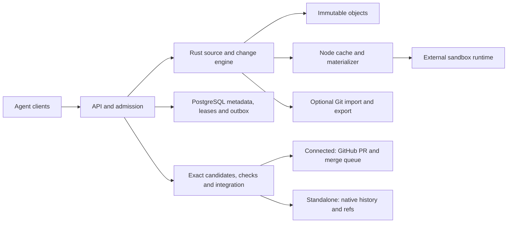

# TreeHarbor

**Source infrastructure for parallel coding agents. Built in Rust.**

TreeHarbor is being built to prepare reproducible workspaces, accept versioned
changes and integrate only the exact code that passed the required checks.
Use GitHub as the authority in **Connected** mode, or native history and refs
in **Standalone** mode. Both share one Rust engine.

> **Development snapshot — not ready for production.** The current code contains
> the immutable object engine, local object storage, native history queries,
> PostgreSQL transaction/outbox primitives, object retention, durable native ChangeSet
> intake, protected source reads, native file preparation/sparse expansion and exact
> validation predicates, repository-scoped credentials, immutable source profiles
> and authenticated command handling. Native graph uploads now support bounded,
> resumable sessions through [binary HTTP and CLI](docs/source-uploads.md).
> [Native directory import](docs/native-import.md) captures explicit paths into a
> durable local pack and resumes upload without rereading the original source.
> [Git bundle import](docs/git-import.md) adds complete pinned commit ancestry,
> preserving original Git IDs for re-export.
> [Live source export](docs/live-source-export.md) downloads registered native
> history from the server into a verified pack for reimport or Git restoration.
> Owners can [list and download baseline files](docs/source-reads.md) through the
> same scoped service, with exact workspace context and verified blob content.
> A development HTTP server over a private Unix socket and a CLI now expose the
> authenticated command boundary. An experimental [task supervisor](docs/runtime-supervisor.md)
> adds a process-lifetime primitive for an external Linux sandbox. An experimental
> [runtime controller](docs/runtime-controller.md) adds durable local create/start/remove
> intents and verified external execution. [Managed runs](docs/managed-runs.md) now bind
> owner requests to prepared files, bounded gVisor execution and recoverable results.
> [Immutable change proposals](docs/change-proposals.md) add resumable blob uploads
> and server-computed ChangeSets through the local API/CLI, with original run lineage.
> Experimental [managed seals](docs/managed-seals.md) capture selected files after
> verified runtime removal and separately accept them as immutable ChangeSets.
> A [native merge library](docs/native-merge.md) now computes bounded three-way
> snapshot results and structured conflicts. [Native integration](docs/native-integration.md)
> adds durable refs, serial admission, scoped checks/reviews and atomic publication
> through CLI/API. [Scoped history queries](docs/native-history.md) expose commits,
> ancestry and merge bases without Git. [ChangeSet rebase](docs/change-rebase.md)
> creates a new immutable version on an exact base, retaining its original run and
> requiring new checks. [Review diffs](docs/review-diff.md) show exact retained
> ChangeSet versions, prepared integration candidates or registered revisions,
> with bounded text and path pages.
> Experimental
> [managed native checks](docs/managed-checks.md) execute approved offline commands
> on exact candidates. Automatic queue/CI
> scheduling is still pending.
> An experimental [MCP stdio adapter](docs/mcp.md) now exposes scoped agent tools
> through the same local service. Optimized caching and remote command transport
> are still pending.
> [Preparation reservations](docs/workspace-preparations.md) now persist node/storage
> ownership and fence retries before physical work. The [local preparation node](docs/local-node.md)
> now materializes files, acknowledges exact placements and recovers them after process loss.
> Explicit [workspace cleanup](docs/workspace-cleanup.md) connects owner drain,
> verified runtime removal and durable deletion to safe slot reuse.
> [GitHub App connections](docs/github-connection.md) now support durable repository
> bindings and revocable, assigned-bridge verification with read-only tokens.
> [Exact GitHub source import](docs/github-import.md) adds owner-requested full-history
> download and resumable source acceptance through the assigned bridge.
> [Accepted-version projection](docs/github-projection.md) prepares and exports an
> exact ChangeSet version through a separately authorized publisher bridge.
> A [branch transport library](docs/github-publisher-transport.md) adds scoped App
> writes and exact expected-old updates.
> [Publication requests](docs/github-publications.md) now retain owner intent,
> one-shot dispatch receipts and recovery observations. The trusted
> [`github publish` command](docs/github-publications.md#publisher-command) joins
> these records to branch transport. A [live synthetic acceptance](docs/evidence/connected-live-20261024.json)
> passed two isolated agent tasks through real App branch/PR publication and exact
> head-check capture, including recovery after service restart.
> [Pull request delivery](docs/github-pulls.md) adds explicit PR creation and text
> updates with retained identities and recovery after a lost response.
> [Check observations](docs/github-inspections.md) capture selected App-issued checks
> on the exact PR head and detect head/base/ruleset drift.
> Experimental [queue delivery](docs/github-queues.md) adds explicit owner permission,
> one-shot native queue requests and recovery of retained asynchronous results.
> Explicit [queue removal](docs/github-dequeue.md) adds PR-scoped owner requests,
> one-shot dequeue and recovery without automatically replaying mutations.
> [Signed event intake](docs/github-events.md) now retains authenticated merge-group
> callbacks with explicit repository channels and recovery after process loss.
> A [dedicated HTTPS ingress recipe](docs/webhook-https.md) connects that receiver
> through Caddy while leaving the command socket private.
> [Event recovery](docs/github-event-recovery.md) adds owner-bounded delivery scans,
> durable one-shot redelivery and signed-content correlation after interruption.
> A [live queue acceptance](docs/evidence/connected-queue-live-20261024.json) retained
> signed callbacks, merged a passing group and rejected an incompatible combined
> candidate. [Retained group observations](docs/github-queue-groups.md) now preserve
> membership and exact parents across later reads and process loss.
> [Candidate checks](docs/github-group-checks.md) retain exact suite/run identities
> without substituting a later same-SHA push check.
> [Workflow policies](docs/github-workflow-policy.md) compare exact executed root-file
> bytes against explicit owner approval and fence dispatch after policy replacement.
> [Managed Connected checks](docs/github-managed-checks.md) can run an owner-approved
> offline program on an exact imported PR head or queue candidate. An experimental
> [required-check transport](docs/github-required-check-transport.md) adds exact
> App check creation and read-only recovery. [Managed check publication](docs/github-check-publications.md)
> connects protected execution evidence to owner requests, one-shot dispatch and a
> recoverable CLI journal. Full live Connected acceptance remains pending.
> [Published candidate evidence](docs/github-publication-proof.md) checks exact final
> identity and target ancestry. Complete policy/group-check verification remains pending. The live tasks are
> scripted fixtures, not an LLM benchmark.
> Neither end-to-end mode is released. No packaged installation is available yet.
> See [implementation status](docs/implementation-status.md) for evidence and gaps.

## Why build this?

Parallel agents repeatedly prepare similar source trees, submit overlapping
changes and outlive the revision on which their checks ran. We are targeting
teams running frequent automated code changes in their own infrastructure.
The intended benefit is lower preparation cost and shorter change-to-merge time
without requiring a migration away from GitHub.

Git worktrees, sparse checkout and correctly configured caches are strong
baselines. TreeHarbor has **not yet demonstrated a performance advantage** over
them, Anthropic Scion or other implementations. We will publish reproducible
measurements, including server, cleanup and build costs.

## Current developer quickstart

Prerequisites: Git, a C compiler, CMake, OpenSSL (for signature tests), and
[Rust via rustup](https://rustup.rs/). The pinned toolchain
is in `rust-toolchain.toml`. First dependency downloads and compilation depend
on your machine and network; this is not the planned five-minute product install.

```sh
git clone https://github.com/ArtAndrew/TreeHarbor.git
cd TreeHarbor
cargo test --workspace --locked
cargo fmt --all -- --check
cargo clippy --workspace --all-targets --locked -- -D warnings
```

The core tests need neither GitHub credentials nor a Git subprocess. The merge
reference tests use the installed Git as an independent oracle; the native engine
does not invoke it. The separate
[database suite](docs/database-development.md) requires disposable PostgreSQL. They exercise
immutable trees, change preconditions, binary paths, malformed objects, local
storage races, catalog retention and native DAG ancestry. They do not prove server durability or
runtime isolation.

To build and exercise the local server and credential administration, follow the
[local service guide](docs/local-service.md). It requires PostgreSQL and currently
exercises the control plane. [Live source export](docs/live-source-export.md)
downloads complete pinned history; the [Git export guide](docs/git-export.md)
converts a completed local pack to a self-contained bundle.
The [GitHub queue acceptance kit](examples/github-queue/README.md) provides a small
Rust workload whose independent changes pass but whose clean text merge fails a
combined check. It includes a real `merge_group` workflow and evidence-capture
tools; live Connected acceptance remains unfinished.
The [local node guide](docs/local-node.md) prepares native
workspace files. [Managed runs](docs/managed-runs.md) add experimental Linux execution
with explicitly provisioned bounded volumes and approved runtime profiles.

## Architecture and modes



This diagram is the target architecture, not a list of shipped components.

| | Connected | Standalone |
|---|---|---|
| Published main authority | GitHub | TreeHarbor |
| Review and admission | GitHub policies and checks | Native policies and checks |
| Native core | Shared | Shared |
| Git process | Allowed in bridge | Optional interop only; none on native main path |
| Release status | Planned | Planned |

A workspace is files, **not a sandbox**. Credentials, process/network isolation
and resource enforcement require a separate runtime boundary. A passed check is
valid only for its exact candidate and declared context. Neither textual merge
success nor CI guarantees detection of every semantic incompatibility.

## Explore and contribute

- [Roadmap and release gates](ROADMAP.md)
- [Contributing](CONTRIBUTING.md) and [security](SECURITY.md)

## License

TreeHarbor is **source-available under the standard [Elastic License 2.0](LICENSE)**,
not OSI open source. Both modes and all original components use this license.
There is no workspace quota, usage license meter, trial expiry or automatic
conversion to another license. Third-party components retain their own licenses.

ELv2 restricts offering a hosted or managed service that provides third parties
access to a substantial set of the software's features, circumventing license-key
functionality, and removing notices. The full license controls. Large internal
deployments do not require a commercial license merely because of their size.

Separate Provider/OEM terms for managed service delivery, deployment assistance
and support are planned commercial offerings; no prices or SLA are announced.
For licensing inquiries, contact [ArtAndrew](https://github.com/ArtAndrew).

Copyright 2026 Artishchev Andrey Borisovich.
