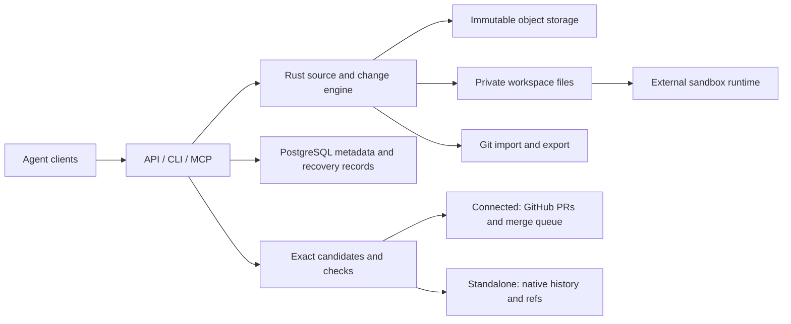

# TreeHarbor

**Self-hosted source infrastructure for parallel coding agents. Built in Rust.**

TreeHarbor prepares workspaces from exact revisions, saves agent changes as
immutable proposals, and connects checks to the exact code they tested. It is
designed to help teams run many automated coding tasks while preserving their
source history and controlling how changes reach the main branch.

Keep your existing GitHub process with **Connected**, or use TreeHarbor's own
history, branches and integration queue with **Standalone**. Both use the same
Rust engine and the same license.

> **Early development — no installable release yet.** You can build and evaluate
> the current components on disposable test repositories. Both modes are partially
> implemented; neither has passed all release gates. Production use is not supported.
> [What works](#what-works-today) · [What remains](#what-remains-before-a-full-release) ·
> [Try the development build](#try-the-development-build) · [Detailed evidence](docs/implementation-status.md)

## Who is it for?

- **Platform and developer productivity teams** running repeated code migrations,
  maintenance jobs or many concurrent agent tasks in their own infrastructure.
- **Agent platform developers** who need an API for source files, durable proposals
  and the status of checks and integration.
- **Infrastructure engineers** evaluating how to reduce repeated source preparation
  and recover work when a worker fails or a request is retried.

For example, two agents can propose changes to the same service from one starting
revision. TreeHarbor keeps each proposal and its checks separate, then requires
checks of the combined candidate before it can be accepted. Failed work can be
revised without losing the original proposal or confusing its checks with the repair.

The intended benefit is lower workspace preparation cost and less coordination
between an agent's edit and accepted code. **A performance advantage has not yet
been measured.** Tuned Git worktrees, partial/sparse checkout and caches remain
the comparison baseline.

## The workflow

```text
Exact source revision
  → separate agent workspaces
  → immutable, versioned change proposals
  → checks of the exact proposed or combined revision
  → conflict/failure, or integration into the target branch
  → retained history, Git export and workspace cleanup
```

Each proposal keeps its base revision and agent-run identity. Changing the code
does not carry a previous revision's passing checks forward. A text merge alone
does not establish that two changes work together; the combined result needs checks.

## What works today?

Status as of **2026-10-26**. “Implemented” describes the stated component and its
tests, not completion of the entire product.

| Area | Implemented and tested | Still incomplete |
| --- | --- | --- |
| Rust source engine | Immutable objects, snapshots, history, versioned changes and exact revision identities | Larger-repository performance and compatibility coverage |
| Workspaces | Full/sparse file preparation, expansion preserving edits, explicit drain/cleanup and recovery | Optimized caching, automatic scheduling and Git-compatible workspace format |
| Agent execution | Managed Linux tasks through external gVisor, resource limits, capture after runtime removal and process-loss recovery | Automated runtime provisioning and node replacement |
| Developer interfaces | Local authenticated API and CLI; experimental MCP stdio adapter | Packaged onboarding and remote service transport |
| Connected | Real GitHub import, branch/PR publication, managed required checks, versioned branch-policy fences, queue requests, candidate/final-history evidence and signed events | Complete host-policy/admission certification and unattended operation |
| Standalone | Native refs/history, candidate checks/reviews, merge, single-ChangeSet rebase and publication without Git/GitHub on the native path | Full lifecycle, broader history rewriting and fenced migration between modes |
| Data recovery and interop | Durable transaction/retry paths, object retention and full-history Git import/export for supported inputs | Full server backup/restore, automatic GC/reconciliation and S3 backend |

A [live synthetic test](docs/evidence/connected-live-20261024.json) ran two isolated
scripted agents and published their proposals as real GitHub PRs. A subsequent
[queue test](docs/evidence/connected-queue-live-20261024.json) merged a passing change
and rejected an incompatible combined candidate. These are bounded acceptance
results, not an LLM benchmark or proof that the complete Connected release is ready.
A [managed-check trial](docs/evidence/connected-required-check-live-20261025.json)
subsequently ran fresh checks for the original PR, its failing combined candidate,
a scripted repair and the repair's combined candidate. The repair merged through
GitHub's queue; TreeHarbor matched the checked candidate to the final commit and
recovered a check receipt after a server crash without publishing it twice.

The CI suite exercises Rust on Linux/macOS, real PostgreSQL contracts, and actual
gVisor tasks on Linux x86-64/ARM64. See [CI runs](https://github.com/ArtAndrew/TreeHarbor/actions)
and the [implementation ledger](docs/implementation-status.md) for exact evidence,
fixture boundaries and open gates.

## Can I use it now?

**For development and controlled technical evaluation: yes.** Expect a source
build, manual configuration and evolving interfaces. Use disposable repositories
and dedicated test infrastructure. The local service needs PostgreSQL; managed
agent execution additionally needs a supported Linux/gVisor setup and bounded volumes.

**For production or as your only copy of important source code: not yet.** There
are no supported release binaries, one-command installation, complete server
restore procedure or verified unattended lifecycle. Keep ordinary Git and independent
backups while evaluating the project.

A workspace provides files; **the external runtime provides the execution sandbox**.
Agents must not receive publisher credentials. Tests cannot detect every semantic
incompatibility. See [security boundaries](SECURITY.md).

## What remains before a full release?

1. Complete Connected host-policy and admission certification, automatic
   reconciliation, and repeatable operation beyond the bounded live trials.
2. Verify the full Standalone lifecycle and safe transfer of repository authority
   between modes, with a single writer throughout.
3. Finish storage and operations: S3, automatic cleanup/GC, full server backup and
   restore, remote workers and recovery after node replacement.
4. Ship and test installation, upgrade/removal, CLI/container artifacts, checksums,
   dependency inventory (SBOM), build provenance and a reproducible agent demo.
5. Publish raw comparisons with tuned Git and available alternatives, including
   cold/warm caches, useful-action latency, server costs and cleanup.

An earlier, limited alpha needs tested installation artifacts, one documented
workflow that users can reproduce, recovery/export instructions, and explicit
known limitations. Those packaging gates are still open. It will not imply
production readiness or completion of both modes. The
[roadmap](ROADMAP.md) and [release gates](docs/implementation-status.md#release-gate-ledger)
track the remaining work.

## Try the development build

Prerequisites: Git, a C compiler, CMake, OpenSSL for signature tests, and
[Rust via rustup](https://rustup.rs/). The toolchain is pinned in
`rust-toolchain.toml`. Downloads and compilation take additional time; these
commands build developer tools, not a configured deployment.

```sh
git clone https://github.com/ArtAndrew/TreeHarbor.git
cd TreeHarbor
cargo build -p treeharbor-service --locked
./target/debug/treeharbor --help
cargo test --workspace --locked
```

The ordinary suite includes Git-based reference comparisons; the native engine
does not call Git. PostgreSQL and runtime acceptance suites run separately and
are required for their respective guarantees.

Next steps:

- [Local server and CLI](docs/local-service.md), [PostgreSQL tests](docs/database-development.md).
- [Workspace preparation](docs/local-node.md), [managed agent runs](docs/managed-runs.md).
- [GitHub connection](docs/github-connection.md), [queue acceptance example](examples/github-queue/README.md).
- [Native integration](docs/native-integration.md), [managed checks](docs/managed-checks.md).
- [MCP tools](docs/mcp.md), [Git import](docs/git-import.md), [Git export](docs/git-export.md).

## How the modes fit together



These are responsibility boundaries; the table above describes implementation status.

| | Connected | Standalone |
| --- | --- | --- |
| Authority for published main | GitHub | TreeHarbor |
| Review and integration | GitHub policies and queue | Native policies and queue |
| Role of Git | Import/export and host bridge | Optional import/export; absent from the native main path |
| Current maturity | Partial; development only | Partial; development only |

Each repository has one authority. Switching modes is a migration, not two systems
writing the same main branch. Both modes are self-hosted and share the Rust core.

## Contribute

See [CONTRIBUTING](CONTRIBUTING.md), [SECURITY](SECURITY.md) and the
[roadmap](ROADMAP.md). Reproducible bug reports, onboarding feedback and workload
measurements are useful contributions. External code contributions require the
documented contribution-rights process before merge.

## License

TreeHarbor is **source-available under the standard [Elastic License 2.0](LICENSE)**,
not OSI open source. Both modes and all original components use this license.
There is no workspace quota, usage license meter, trial expiry or automatic
conversion to another license. Third-party components retain their own licenses.

ELv2 restricts offering a hosted or managed service that provides third parties
access to a substantial set of the software's features, circumventing license-key
functionality, and removing notices. The full license controls. Large internal
deployments do not require a commercial license merely because of their size.

Separate Provider/OEM terms for managed service delivery, deployment assistance
and support are planned commercial offerings; no prices or SLA are announced.
For licensing inquiries, contact [ArtAndrew](https://github.com/ArtAndrew).

Copyright 2026 Artishchev Andrey Borisovich.
