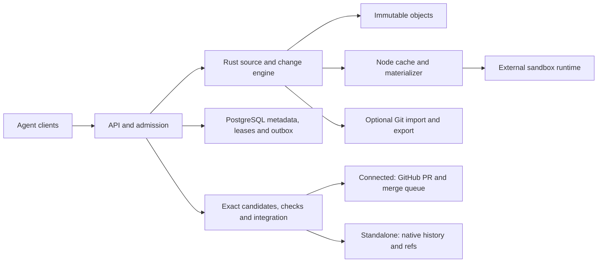

# TreeHarbor

**Source infrastructure for parallel coding agents. Built in Rust.**

TreeHarbor is being built to prepare reproducible workspaces, accept versioned
changes and integrate only the exact code that passed the required checks.
Use GitHub as the authority in **Connected** mode, or native history and refs
in **Standalone** mode. Both share one Rust engine.

> **Development snapshot — not ready for production.** The current code contains
> the immutable object engine, local object storage, native history queries,
> PostgreSQL transaction/outbox primitives, object retention, durable native ChangeSet
> intake, protected source reads, native file preparation/sparse expansion and exact
> validation predicates. These are internal libraries; runtime binding, node recovery,
> optimized caching and authenticated service integration are still pending.
> Neither end-to-end mode is released. There is no installable server or CLI yet.
> See [implementation status](docs/implementation-status.md) for evidence and gaps.

## Why build this?

Parallel agents repeatedly prepare similar source trees, submit overlapping
changes and outlive the revision on which their checks ran. We are targeting
teams running frequent automated code changes in their own infrastructure.
The intended benefit is lower preparation cost and shorter change-to-merge time
without requiring a migration away from GitHub.

Git worktrees, sparse checkout and correctly configured caches are strong
baselines. TreeHarbor has **not yet demonstrated a performance advantage** over
them, Anthropic Scion or other implementations. We will publish reproducible
measurements, including server, cleanup and build costs.

## Current developer quickstart

Prerequisites: Git and [Rust via rustup](https://rustup.rs/). The pinned toolchain
is in `rust-toolchain.toml`. First dependency downloads and compilation depend
on your machine and network; this is not the planned five-minute product install.

```sh
git clone https://github.com/ArtAndrew/TreeHarbor.git
cd TreeHarbor
cargo test --workspace --locked
cargo fmt --all -- --check
cargo clippy --workspace --all-targets --locked -- -D warnings
```

The core tests need neither GitHub credentials nor a Git subprocess. The separate
[database suite](docs/database-development.md) requires disposable PostgreSQL. They exercise
immutable trees, change preconditions, binary paths, malformed objects, local
storage races, catalog retention and native DAG ancestry. They do not prove server durability or
runtime isolation.

## Architecture and modes



This diagram is the target architecture, not a list of shipped components.

| | Connected | Standalone |
|---|---|---|
| Published main authority | GitHub | TreeHarbor |
| Review and admission | GitHub policies and checks | Native policies and checks |
| Native core | Shared | Shared |
| Git process | Allowed in bridge | Optional interop only; none on native main path |
| Release status | Planned | Planned |

A workspace is files, **not a sandbox**. Credentials, process/network isolation
and resource enforcement require a separate runtime boundary. A passed check is
valid only for its exact candidate and declared context. Neither textual merge
success nor CI guarantees detection of every semantic incompatibility.

## Explore and contribute

- [Roadmap and release gates](ROADMAP.md)
- [Contributing](CONTRIBUTING.md) and [security](SECURITY.md)

## License

TreeHarbor is **source-available under the standard [Elastic License 2.0](LICENSE)**,
not OSI open source. Both modes and all original components use this license.
There is no workspace quota, usage license meter, trial expiry or automatic
conversion to another license. Third-party components retain their own licenses.

ELv2 restricts offering a hosted or managed service that provides third parties
access to a substantial set of the software's features, circumventing license-key
functionality, and removing notices. The full license controls. Large internal
deployments do not require a commercial license merely because of their size.

Separate Provider/OEM terms for managed service delivery, deployment assistance
and support are planned commercial offerings; no prices or SLA are announced.
For licensing inquiries, contact [ArtAndrew](https://github.com/ArtAndrew).

Copyright 2026 Artishchev Andrey Borisovich.
