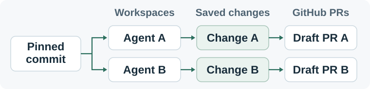

# TreeHarbor

**Self-hosted, Git-compatible workspaces for parallel coding agents.** Run several tasks from the same commit, keep each submitted change after its workspace is gone, and open a GitHub draft pull request for each one. TreeHarbor records the base revision and agent run behind every change.

Built for platform teams running code migrations and maintenance jobs with their own agents. Signed Linux alpha for test repositories. The reference deployment uses PostgreSQL and Docker with gVisor.

[Watch the 36-second demo](docs/demo.md) · [Try it on Linux](docs/try-treeharbor.md) · [Download signed packages](https://github.com/ArtAndrew/TreeHarbor/releases)

## Two agents edit the same file

In a recorded trial, one task changed memory per worker and the other changed the worker count. Both edited `src/lib.rs` from the same commit. Two scripted agents produced separate draft PRs. After both workspaces were deleted, each change still exported to Git. [Memory change, PR #4](https://github.com/TreeHarbor/TreeHarbor-acceptance/pull/4) · [Worker-count change, PR #5](https://github.com/TreeHarbor/TreeHarbor-acceptance/pull/5)

## What works today

- **Connected.** Keep your GitHub repository, CI and reviewers. Tasks can request private Git metadata when they need Git commands. TreeHarbor publishes saved changes through your GitHub App. [Connected setup](docs/connected-pr-preview.md) · [Agent controller API](docs/remote-tasks-v1.md) · [Experimental MCP adapter](docs/mcp.md)
- **Standalone, experimental.** TreeHarbor owns the branch history and merge queue. Run two agents without a GitHub account, resolve their conflict and export the resulting branches to Git. [Standalone example](examples/standalone/README.md)

## First run and repeat runs

Four tasks at a time on an 8,195-file repository, using a two-CPU Linux ARM64 VM and the 0.1.29 code. TreeHarbor used file-only copy-on-write workspaces. Git worktrees included Git metadata.

| Time to read a file | TreeHarbor | Git mirror + worktree |
| --- | ---: | ---: |
| First four workspaces, including local source setup | 12.93 s | 0.75 s |
| Repeat workspaces, median per task | 0.18 s | 0.49 s |

The first row adds the measured setup steps and one four-task batch. The second covers 44 repeat reads per system. Both use local source. [Method, limitations and raw samples](docs/benchmark-preparation.md#four-parallel-workspaces-with-local-setup)

## What inspired it

Anthropic’s Scion inspired the separation of workspaces from source history. OpenAI’s Pando showed how Git can stay part of the daily workflow. TreeHarbor brings parallel agent runs back to a team's ordinary pull requests. [Scion](https://www.anthropic.com/research/redesigning-source-control) · [Pando](https://openai.com/index/scaling-git-at-openai/)

Trying it with your team? A report with your repository size, parallel task count and first setup hurdle helps us choose the next improvement. [Pilot discussion](https://github.com/ArtAndrew/TreeHarbor/discussions/144)

[Deployment diagram](docs/connected-pr-preview.md#system-layout) · [Implementation status](docs/implementation-status.md) · [Roadmap](ROADMAP.md) · [Contributing](CONTRIBUTING.md)

## License

Source-available under the [Elastic License 2.0](LICENSE).
