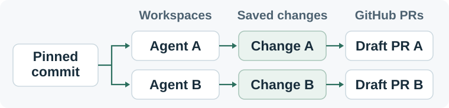

# TreeHarbor

**Self-hosted workspaces for parallel coding agents.**

Run agents from the same commit, keep their changes after workspace cleanup,
and send each change to GitHub as a draft PR. Built for platform teams running
code migrations and maintenance jobs with their own agents.

[**Install v0.1.19-alpha.1**](docs/try-treeharbor.md) ·
[Watch the 36-second demo](docs/demo.md) ·
[Signed Linux packages](https://github.com/ArtAndrew/TreeHarbor/releases/tag/v0.1.19-alpha.1)

**Alpha for test repositories.** Setup is manual on Linux with PostgreSQL.
The two-agent walkthrough uses gVisor for execution isolation.

## What works today

- **Connected.** Use your existing GitHub CI, review and merge process.
  Each saved change records its starting revision and agent run, and you can
  export it to Git after cleanup. Agents that need Git commands can use a
  [workspace with private Git metadata](docs/local-node.md#prepare-an-existing-native-workspace).
- **Standalone (experimental).** Start an [empty native repository](docs/native-integration.md#start-a-new-project-with-empty-history),
  publish changes under TreeHarbor review and check policies, and export the
  history to Git when needed.

Use your own agent controllers to claim tasks, download pinned source and submit
changes over HTTPS. [Controller guide](docs/remote-tasks-v1.md) ·
[Rust CLI](docs/agent-commands.md) · [Experimental MCP adapter](docs/mcp.md).

## Reuse the source between tasks

[Copy-on-write workspaces](docs/experimental-cow.md) reuse prepared source and
give each agent a writable layer. In a Linux ARM64 development benchmark with
four workspaces and 8,195 files, reusing the imported Git pack cut first
preparation from **1.70–1.73 s to 0.85–0.87 s** after import. Git worktree
took **about 0.51 s** on those first reuse runs. Repeat batches took
**0.14–0.16 s** with TreeHarbor and **about 0.65 s** with Git worktree.
[Method and raw data](docs/benchmark-preparation.md#reusing-the-pack-from-import--10-november-2026)

## What inspired it

Anthropic’s Scion inspired the separation of workspaces from source history.
OpenAI’s Pando reinforced the value of keeping existing Git workflows.
TreeHarbor starts with the handoff from agent tasks to your existing review process.
[Scion](https://www.anthropic.com/research/redesigning-source-control) ·
[Pando](https://openai.com/index/scaling-git-at-openai/)

[Deployment layout](docs/connected-pr-preview.md#system-layout) ·
[Status and release gates](docs/implementation-status.md) ·
[Roadmap](ROADMAP.md) ·
[Contributing](CONTRIBUTING.md)

## License

Source-available under [Elastic License 2.0](LICENSE).
