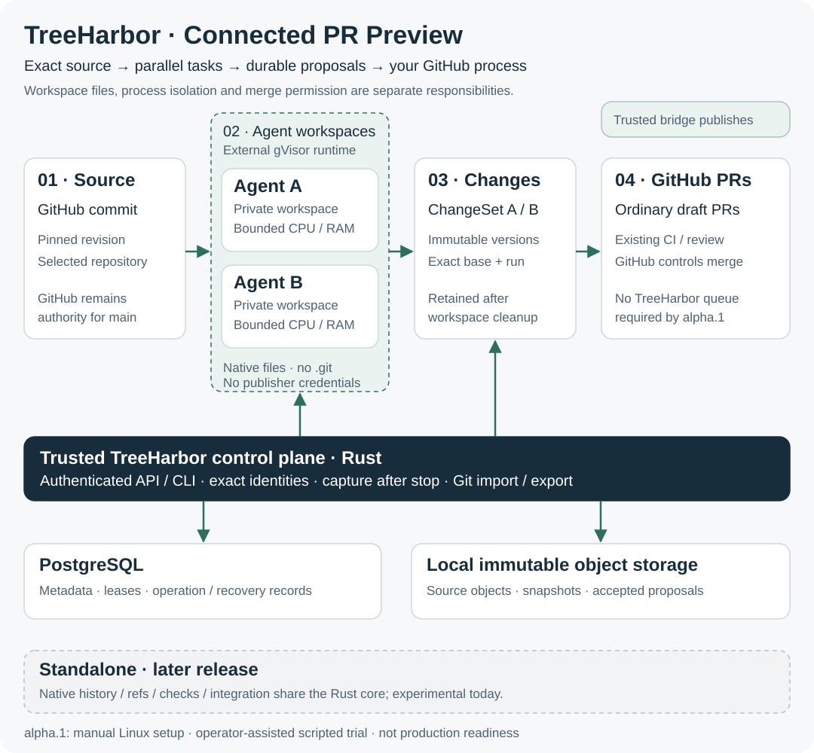

# TreeHarbor

**Self-hosted source infrastructure for parallel coding agents. Built in Rust.**

TreeHarbor prepares workspaces from exact revisions, saves agent changes as
immutable proposals, and connects checks to the exact code they tested. It is
designed to help teams run many automated coding tasks while preserving their
source history and controlling how changes reach the main branch.

Start with **Connected**: keep GitHub as the authority for your main branch,
checks and code review. **Standalone** shares the Rust core and is an experimental
path toward native history and integration; its full release comes later.

TreeHarbor is inspired by Anthropic's [Redesigning source control at Anthropic](https://www.anthropic.com/research/redesigning-source-control)
(Scion; published October 13, 2026, updated October 15). The shared idea is to
separate source data and proposed changes from disposable agent workspaces.
TreeHarbor is an independent implementation and is not affiliated with Anthropic.

> **The Connected PR Preview is available in [signed alpha releases](https://github.com/ArtAndrew/TreeHarbor/releases).**
> Signed Linux packages and the exact tested scope are in the release notes.
> Evaluate on disposable pilot repositories. The full Connected and Standalone
> releases remain incomplete; production use is not supported.
> [What works](#what-works-today) · [What remains](#what-remains-before-a-full-release) ·
> [Try the development build](#try-the-development-build) · [Detailed evidence](docs/implementation-status.md)

## Who is it for?

- **Platform and developer productivity teams** running repeated code migrations,
  maintenance jobs or many concurrent agent tasks in their own infrastructure.
- **Agent platform developers** who need an API for source files, durable proposals
  and the status of checks and integration.
- **Infrastructure engineers** evaluating how to reduce repeated source preparation
  and recover work when a worker fails or a request is retried.

For example, two agents can propose changes to the same service from one starting
revision. TreeHarbor keeps each proposal and its checks separate, then requires
checks of the combined candidate before it can be accepted. Failed work can be
revised without losing the original proposal or confusing its checks with the repair.

The intended benefit is lower workspace preparation cost and less coordination
between an agent's edit and accepted code. **A performance advantage has not yet
been measured.** Tuned Git worktrees, partial/sparse checkout and caches remain
the comparison baseline.

## The workflow



In alpha.1, agents run in separate native workspaces, the Rust engine accepts their
stopped-file captures as immutable changes, and the trusted bridge publishes PRs.
GitHub handles CI, review, conflicts and merge. Publisher credentials stay outside
agent workspaces. The runtime supplies process isolation and resource limits.

The [0.1.4-alpha.1 preview](https://github.com/ArtAndrew/TreeHarbor/releases/tag/v0.1.4-alpha.1)
also supports [external agent API contexts](docs/external-api-runs.md): use your own
execution environment, read an exact base and submit immutable changes without
TreeHarbor-managed execution. The client supplies execution isolation; registering
an external task does not attest that it ran or passed tests.

Each proposal keeps its base revision and agent-run identity. Changing the code
does not carry a previous revision's passing checks forward. A text merge alone
does not establish that two changes work together; the combined result needs checks.

## What differs from Scion?

Scion is Anthropic's internal system for an unusually large workload. Our starting
point is a self-hosted rollout alongside an existing GitHub repository.
The Scion column summarizes [Anthropic's account](https://www.anthropic.com/research/redesigning-source-control),
checked October 28, 2026; TreeHarbor's column distinguishes released and experimental scope.

| Decision | Scion as described by Anthropic | TreeHarbor today |
| --- | --- | --- |
| Adoption | Migrated monorepo with bespoke review, search and CI | Connected alpha.1 returns ordinary GitHub PRs; existing review/CI/main remain authoritative |
| Deployment | Spanner, blob storage and tiered regional caches for its fleet | One documented PostgreSQL/local-storage Linux profile; manual setup, no vendor cloud account required |
| Files | Sparse and virtualized checkouts | Full/sparse materialized files; virtual filesystem is not implemented; alpha.1 uses native workspaces without `.git` |
| Data model | First-parent file deltas plus derived indexes | Content-addressed snapshots and versioned ChangeSets with explicit base/run lineage |
| Integration | Emphasis on post-merge and pre-deploy testing at its scale | Alpha.1 delegates checks/review/merge to GitHub; managed queue and Standalone remain experimental |
| Distribution | Internal deployment described in the article | Signed alpha Linux packages and source under standard ELv2; early controlled evaluation |

The practical benefits to evaluate are **incremental adoption**, **retained agent
proposals** and **explicit execution/publisher boundaries**. You can try the PR path
without moving authority away from GitHub, inspect the implementation, and export
accepted source to ordinary Git. These are architectural choices and scoped trial
results, not evidence of better throughput, lower cost or stronger security than
Scion or tuned Git. Performance comparisons and unassisted onboarding remain open.

## What works today?

Status as of **2026-10-30**. “Implemented” describes the stated component and its
tests, not completion of the entire product.

| Area | Implemented and tested | Still incomplete |
| --- | --- | --- |
| Rust source engine | Immutable objects, snapshots, history, versioned changes and exact revision identities | Larger-repository performance and compatibility coverage |
| Workspaces | Full/sparse file preparation, expansion preserving edits, explicit drain/cleanup and recovery | Optimized caching, automatic scheduling and Git-compatible workspace format |
| Agent execution | Managed Linux tasks through external gVisor, resource limits, capture after runtime removal and process-loss recovery | Automated runtime provisioning and node replacement |
| Developer interfaces | Local authenticated API/CLI, external task contexts and an experimental MCP stdio adapter | Packaged onboarding and remote service transport |
| Connected | Real GitHub import, branch/PR publication, managed required checks, versioned branch-policy fences, queue requests, candidate/final-history evidence and signed events | Complete host-policy/admission certification and unattended operation |
| Standalone | Native refs/history, candidate checks/reviews, merge, single-ChangeSet rebase and publication without Git/GitHub on the native path | Full lifecycle, broader history rewriting and fenced migration between modes |
| Data recovery and interop | Durable transaction/retry paths, object retention, cold backup creation/verification and full-history Git import/export for supported inputs | Safe general restore activation, Connected recovery, automatic GC/reconciliation and S3 backend |

A [live synthetic test](docs/evidence/connected-live-20261024.json) ran two isolated
scripted agents and published their proposals as real GitHub PRs. A subsequent
[queue test](docs/evidence/connected-queue-live-20261024.json) merged a passing change
and rejected an incompatible combined candidate. These are bounded acceptance
results, not an LLM benchmark or proof that the complete Connected release is ready.
A [managed-check trial](docs/evidence/connected-required-check-live-20261025.json)
subsequently ran fresh checks for the original PR, its failing combined candidate,
a scripted repair and the repair's combined candidate. The repair merged through
GitHub's queue; TreeHarbor matched the checked candidate to the final commit and
recovered a check receipt after a server crash without publishing it twice.

The CI suite exercises Rust on Linux/macOS, real PostgreSQL contracts, and actual
gVisor tasks on Linux x86-64/ARM64. See [CI runs](https://github.com/ArtAndrew/TreeHarbor/actions)
and the [implementation ledger](docs/implementation-status.md) for exact evidence,
fixture boundaries and open gates.

## Can I use it now?

**For development and controlled technical evaluation: yes.** Use a published
[signed preview package](https://github.com/ArtAndrew/TreeHarbor/releases), or build from source. Expect manual configuration
and evolving interfaces. Use disposable repositories
and dedicated test infrastructure. The local service needs PostgreSQL; managed
agent execution additionally needs a supported Linux/gVisor setup and bounded volumes.

**For production or as your only copy of important source code: not yet.** There
is no verified unattended lifecycle, complete server restore procedure or
one-command host provisioning. Keep ordinary Git and independent
backups while evaluating the project.

Development archives now pass offline CLI installation on Linux x86-64 and ARM64.
See [packaging and verification](docs/release-packaging.md). These temporary CI
artifacts are for technical evaluation. Installed-runtime and source-restore
workloads have passed on both architectures; full Connected onboarding and
operational recovery remain in progress.

A workspace provides files; **the external runtime provides the execution sandbox**.
Agents must not receive publisher credentials. Tests cannot detect every semantic
incompatibility. See [security boundaries](SECURITY.md).

## Connected PR Preview workflow

Start with the [operator setup path](docs/connected-pr-preview.md): package,
database, minimal App permissions, local roles and the two-agent example.

The first installable alpha focuses on one reproducible workflow:
**connect a repository → prepare two isolated workspaces → run two agents → save
immutable changes → publish GitHub PRs → clean up.** GitHub's existing checks,
review and merge process handle the proposed code, including overlapping changes.

Small alpha.1.x patches will address installation and workflow problems found by
pilots. Alpha.2 will focus on repeat use, with its exact scope chosen from feedback.
TreeHarbor-managed merge queues and full recovery of GitHub publication state
after a disaster follow in separate releases. Their current implementations remain
experimental and are outside the first alpha's supported workflow.

The [alpha.1 release](https://github.com/ArtAndrew/TreeHarbor/releases/tag/v0.1.0-alpha.1) provides signed Linux x86-64 and ARM64 packages.
Its installed ARM64 workflow passed with two concurrent scripted agents, two real
draft PRs, preserved publication identities on re-entry, safe cleanup and verified
Git export after cleanup. All temporary service access was revoked. See the
[scoped trial report](docs/evidence/connected-pr-preview-20261028.json) for exact identities and limits.
Both architectures passed installed runtime/package CI; the live GitHub trial ran
on ARM64. Setup is manual, and this preview is for controlled pilot repositories.

Standalone will follow in a later release. Its existing native components remain
experimental; both modes continue to share the Rust core and standard ELv2.
See the [release order](ROADMAP.md). Evaluating a development build? Tell us what
you tried, where you got blocked and whether you would run another task using the
[pilot feedback template](.github/ISSUE_TEMPLATE/pilot-feedback.md). Do not share
private source or credentials in a public issue.

An experimental [prepared-agents-to-PR helper](examples/connected-pr/README.md)
reduces manual orchestration over the existing Rust CLI. Its installed scripted
workflow passed the scoped ARM64 trial. An operator must still prepare the service,
runtime, workspaces and scoped credentials; this is not automatic host provisioning
or a ready-made LLM connector.

The [0.1.1-alpha.1 setup patch](https://github.com/ArtAndrew/TreeHarbor/releases/tag/v0.1.1-alpha.1) adds an actionable PostgreSQL
schema diagnostic and the [operator setup path](docs/connected-pr-preview.md).
Its installed ARM64 package passed missing-schema refusal, explicit migration,
healthy startup and graceful shutdown; signed runtime/package CI passed on both
architectures. See [the setup report](docs/evidence/connected-preview-setup-20261028.json). The two-agent GitHub trial
above remains evidence for its original alpha.1 source, not a new patch trial.

The [0.1.2-alpha.1 workspace patch](https://github.com/ArtAndrew/TreeHarbor/releases/tag/v0.1.2-alpha.1)
adds [`client workspace-new`](docs/workspace-new.md): save a generated workspace
ID and request key before sending, then reuse the same state file after a lost
response. It removes manual creation IDs; file preparation and runtime setup
remain explicit. Both signed Linux packages passed installed runtime CI with the
new command. The patch does not repeat the historical live GitHub trial.

The [0.1.3-alpha.1 diagnostic patch](https://github.com/ArtAndrew/TreeHarbor/releases/tag/v0.1.3-alpha.1)
adds [`doctor --config`](docs/doctor.md): check private configuration, local
directories/socket path and PostgreSQL/schema prerequisites before startup, with
redacted repair hints. It does not change setup or certify runtime/GitHub
readiness. Both signed Linux packages passed the installed diagnostic and runtime
scenarios. Use the [operator setup path](docs/connected-pr-preview.md).

The [0.1.5-alpha.1 preparation update](https://github.com/ArtAndrew/TreeHarbor/releases/tag/v0.1.5-alpha.1)
synchronizes newly prepared files in bounded parallel batches while retaining
all required durability steps. It also ships an experimental
[native queue preparation helper](docs/native-advance.md) with a saved retry journal.
Connected PR Preview scope is unchanged. The [source-import benchmark](docs/benchmark-source-import.md)
includes a reproducible local sample with explicit limits; it does not establish
an advantage over tuned Git. Both signed Linux packages passed installed workflows.

The [0.1.6-alpha.1 MCP update](https://github.com/ArtAndrew/TreeHarbor/releases/tag/v0.1.6-alpha.1)
lets a controller [create, inspect and close external tasks through MCP](docs/mcp.md#start-a-task-using-your-own-execution-environment),
read pinned source and submit immutable changes through the same stdio adapter.
Accepted changes survive logical close. The controller supplies execution and
isolation; TreeHarbor does not infer that tests ran or passed. Both signed Linux
packages passed the installed MCP workflow. A real LLM-host trial remains open.

The [0.1.7-alpha.1 task update](https://github.com/ArtAndrew/TreeHarbor/releases/tag/v0.1.7-alpha.1)
adds [`client api-run-new`](docs/external-api-runs.md#save-creation-identities-automatically):
save generated workspace/run IDs and the request key before creating an external
task, then reuse the same state file after a lost reply. A replay after close
returns the original receipt without reopening the task. Both signed Linux
packages passed the installed workflow; execution remains external.

The [0.1.8-alpha.1 backup update](https://github.com/ArtAndrew/TreeHarbor/releases/tag/v0.1.8-alpha.1)
adds [`backup create` and `backup verify`](docs/backup-restore.md) for a stopped
local deployment. It preserves metadata, objects, configuration and explicitly
selected private state. Both signed Linux packages passed the controlled restore
drill. Operators must stop all writers and separately retain unsubmitted workspace
edits; verification does not authorize restarting old workers or GitHub publishers.

## What remains before a full release?

1. Complete Connected host-policy and admission certification, automatic
   reconciliation, and repeatable operation beyond the bounded live trials.
2. Verify the full Standalone lifecycle and safe transfer of repository authority
   between modes, with a single writer throughout.
3. Finish storage and operations: S3, automatic cleanup/GC, full server backup and
   restore, remote workers and recovery after node replacement.
4. Ship and test installation, upgrade/removal, CLI/container artifacts, checksums,
   dependency inventory (SBOM), build provenance and a reproducible agent demo.
5. Publish raw comparisons with tuned Git and available alternatives, including
   cold/warm caches, useful-action latency, server costs and cleanup.

The first, PR-focused alpha needs tested installation artifacts, one documented
workspace-to-PR workflow, recovery/export instructions, and explicit
known limitations. Installation and signing evidence is tracked per preview
release. A preview does not imply production readiness or completion of both modes. The
[roadmap](ROADMAP.md) and [release gates](docs/implementation-status.md#release-gate-ledger)
track the remaining work.

## Try the development build

For the installable preview, start with [the release page](https://github.com/ArtAndrew/TreeHarbor/releases)
and [package verification](docs/release-packaging.md). The commands below build
from source.

Prerequisites: Git, a C compiler, CMake, OpenSSL for signature tests, and
[Rust via rustup](https://rustup.rs/). The toolchain is pinned in
`rust-toolchain.toml`. Downloads and compilation take additional time; these
commands build developer tools, not a configured deployment.

```sh
git clone https://github.com/ArtAndrew/TreeHarbor.git
cd TreeHarbor
cargo build -p treeharbor-service --locked
./target/debug/treeharbor --help
cargo test --workspace --locked
```

The ordinary suite includes Git-based reference comparisons; the native engine
does not call Git. PostgreSQL and runtime acceptance suites run separately and
are required for their respective guarantees.

Next steps:

- [Local server and CLI](docs/local-service.md), [PostgreSQL tests](docs/database-development.md).
- [Workspace preparation](docs/local-node.md), [managed agent runs](docs/managed-runs.md).
- [GitHub connection](docs/github-connection.md), [queue acceptance example](examples/github-queue/README.md).
- [Native integration](docs/native-integration.md), [managed checks](docs/managed-checks.md).
- [MCP tools](docs/mcp.md), [Git import](docs/git-import.md), [Git export](docs/git-export.md).

## How the modes fit together

The diagram above shows the released Connected PR path. PostgreSQL metadata,
immutable source objects, workspace files and the external execution runtime have
separate responsibilities. The bridge has publication access; agents propose
changes without permission to move main. Experimental MCP/queue/native components
are not implied to be supported alpha.1 integrations.

| | Connected | Standalone |
| --- | --- | --- |
| Authority for published main | GitHub | TreeHarbor |
| Review and integration | GitHub policies and queue | Native policies and queue |
| Role of Git | Import/export and host bridge | Optional import/export; absent from the native main path |
| Current maturity | Released PR Preview; full mode incomplete | Experimental; full mode incomplete |

Each repository has one authority. Switching modes is a migration, not two systems
writing the same main branch. Both modes are self-hosted and share the Rust core.

## Contribute

See [CONTRIBUTING](CONTRIBUTING.md), [SECURITY](SECURITY.md) and the
[roadmap](ROADMAP.md). Reproducible bug reports, onboarding feedback and workload
measurements are useful contributions. External code contributions require the
documented contribution-rights process before merge.

## License

TreeHarbor is **source-available under the standard [Elastic License 2.0](LICENSE)**,
not OSI open source. Both modes and all original components use this license.
There is no workspace quota, usage license meter, trial expiry or automatic
conversion to another license. Third-party components retain their own licenses.

ELv2 restricts offering a hosted or managed service that provides third parties
access to a substantial set of the software's features, circumventing license-key
functionality, and removing notices. The full license controls. Large internal
deployments do not require a commercial license merely because of their size.

Separate Provider/OEM terms for managed service delivery, deployment assistance
and support are planned commercial offerings; no prices or SLA are announced.
For licensing inquiries, contact [ArtAndrew](https://github.com/ArtAndrew).

Copyright 2026 Artishchev Andrey Borisovich.
