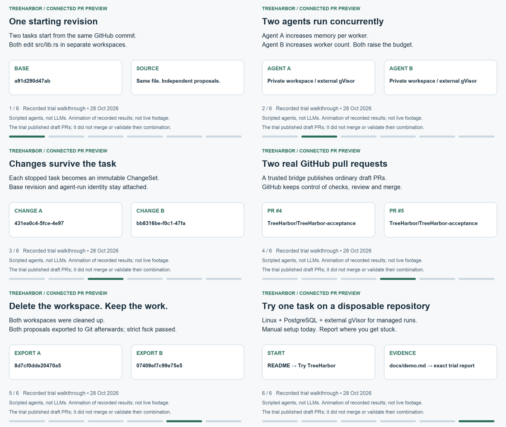

# Two tasks, two PRs, retained work

This 36-second animation walks through a **recorded real trial from 28 October
2026**. It is an illustration of recorded results, not terminal footage or a new
execution. The two agents are deterministic Rust scripts, not LLMs.

[Play or download the 36-second MP4](assets/connected-trial.mp4) ·
[Open the animated GIF directly](https://raw.githubusercontent.com/ArtAndrew/TreeHarbor/main/docs/assets/connected-trial.gif) ·
[Read the steps](#what-happened)

## What happened

1. Both tasks started from Git commit `a91d290d47abeaec32867dd21bb7107bec87ef05`.
2. Two private workspaces ran concurrently in the external gVisor runtime. Both
   scripts edited `src/lib.rs`; A changed memory per worker, B changed worker
   count, and both changed the budget.
3. Stopped-file capture produced two independently retained immutable proposals.
4. The bridge published actual [PR #4](https://github.com/TreeHarbor/TreeHarbor-acceptance/pull/4)
   and [PR #5](https://github.com/TreeHarbor/TreeHarbor-acceptance/pull/5).
5. Both workspaces were cleaned up. Both proposals still exported to Git with
   matching bytes, and `git fsck --strict` passed.

GitHub remained authoritative for CI, review and merge. This trial did **not**
check or merge the combined candidate. The example intentionally includes an
incompatibility that text merging alone does not establish as safe.

[Exact trial report](evidence/connected-pr-preview-20261028.json) records source,
package hashes, task/ChangeSet identities, concurrent runtime observations,
cleanup and export results. It used the installed **0.1.0-alpha.1 ARM64 package**;
this is not a new live trial of the latest package. Both Linux architectures had
package/runtime CI, but the live GitHub trial ran on ARM64 only.

## Try it yourself

Start with [Try TreeHarbor](try-treeharbor.md), then the
[reproducible fixture and operator helper](../examples/connected-pr/README.md).
The host and credentials need manual preparation. No private keys or ready-to-use
credentials are distributed. The source/runtime/permission boundaries are in
[the architecture overview](../README.md#the-workflow).

The storyboard and numbered steps contain the full walkthrough. A scripted
acceptance trial does not establish production
readiness, LLM compatibility, customer adoption or a performance advantage.
