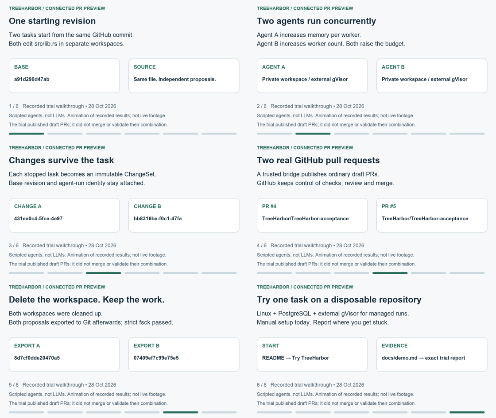

# Two tasks, two PRs, retained work

This 36-second animation walks through a **recorded real trial from 28 October
2026**. It is an illustration of recorded results, not terminal footage or a new
execution. The two agents are deterministic Rust scripts, not LLMs.

[Play or download the 36-second MP4](assets/connected-trial.mp4) ·
[Open the animated GIF directly](https://raw.githubusercontent.com/ArtAndrew/TreeHarbor/main/docs/assets/connected-trial.gif) ·
[Read the steps](#what-happened)

## What happened

1. Both tasks started from Git commit `a91d290d47abeaec32867dd21bb7107bec87ef05`.
2. Two private workspaces ran concurrently in the external gVisor runtime. Both
   scripts edited `src/lib.rs`; A changed memory per worker, B changed worker
   count, and both changed the budget.
3. Stopped-file capture produced two independently retained immutable proposals.
4. The bridge published actual [PR #4](https://github.com/TreeHarbor/TreeHarbor-acceptance/pull/4)
   and [PR #5](https://github.com/TreeHarbor/TreeHarbor-acceptance/pull/5).
5. Both workspaces were cleaned up. Both proposals still exported to Git with
   matching bytes, and `git fsck --strict` passed.

GitHub remained authoritative for CI, review and merge. This trial did **not**
check or merge the combined candidate. The example intentionally includes an
incompatibility that text merging alone does not establish as safe.

The October trial used the installed **0.1.0-alpha.1 ARM64 package**. The report
includes package hashes, run and ChangeSet IDs, concurrent runtime observations,
cleanup and Git export. [October trial report](evidence/connected-pr-preview-20261028.json).

## Retry after GitHub accepts a PR

On November 19, two scripted agents running the signed 0.1.34 alpha on Linux
ARM64 changed `treeharbor-repeat-pair.txt` from the same Git commit. Once GitHub
had accepted the first draft PR, the test stopped the operator helper before
its journal recorded the reply. Resuming with the saved configuration returned
PR #14 and opened PR #15 for the second task. Repeating publication returned
the same two PR numbers. After both workspaces were deleted, each exported Git
commit matched its PR head. [First task, PR #14](https://github.com/TreeHarbor/TreeHarbor-acceptance/pull/14) · [Second task, PR #15](https://github.com/TreeHarbor/TreeHarbor-acceptance/pull/15) · [Signed package](https://github.com/ArtAndrew/TreeHarbor/releases/tag/v0.1.34-alpha.1).

## Verify a merge after restarting TreeHarbor

Later that morning, the signed 0.1.35 alpha on Linux ARM64 read the pending
request for PR #14 twice. Both reads left the request available for its first
enqueue. The operator then submitted it once. GitHub's single-PR queue ran
the required check on `7d85dd1` and merged that same commit 32 seconds later.
PR #15 remained a draft. [Merged PR #14](https://github.com/TreeHarbor/TreeHarbor-acceptance/pull/14) · [Required check](https://github.com/TreeHarbor/TreeHarbor-acceptance/runs/135415904855).

TreeHarbor recorded both signed GitHub events for the group. After a service
restart using the same database, the operator read the same evidence digest
for the merge commit, its tree and both parents. The trial used one PR with
GitHub's `MERGE` method and `ALLGREEN` grouping strategy.
[Trial report](evidence/connected-queue-restart-20261119.json) · [How to verify an observed merge](github-admission-evidence.md#verify-an-observed-merge).

## Try it yourself

Start with [Try TreeHarbor](try-treeharbor.md), then the
[reproducible fixture and operator helper](../examples/connected-pr/README.md).
The host and credentials need manual preparation. No private keys or ready-to-use
credentials are distributed. The source/runtime/permission boundaries are in
[the deployment layout](connected-pr-preview.md#system-layout).

The storyboard and numbered steps contain the full walkthrough. A scripted
acceptance trial does not establish production
readiness, LLM compatibility, customer adoption or a performance advantage.
