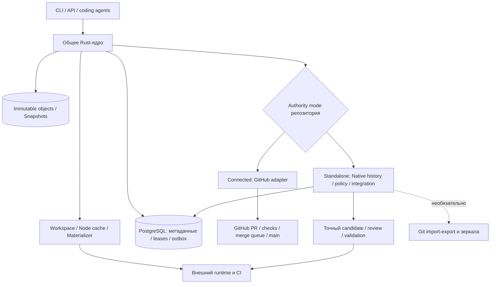

# ADR-004 — Connected и Standalone на общем ядре TreeHarbor

Дата: 21 октября 2026 года. Статус: проработанное архитектурное предложение по запросу пользователя о самостоятельной версии уровня Scion. Это спецификация будущей разработки, не реализованная функция и не разрешение начинать код. Первый шестинедельный пилот остаётся Connected с GitHub; самостоятельный режим имеет отдельные этапы и критерии готовности.

Дополняет [архитектуру](TREEHARBOR_ARCHITECTURE.md), [исследование](TREEHARBOR_RESEARCH.md) и [план](TREEHARBOR_DELIVERY.md). Rust и гарантии сохранения данных не меняются. Актуальное лицензионное решение — стандартная ELv2 без порога workspace для обоих режимов по [ADR-005](ADR-005-ELV2-ADOPTION.md); Provider/OEM и права на contributions описаны в ADR-003.

## 1 Зачем два режима

| Вопрос | Connected | Standalone |
|---|---|---|
| Кто управляет опубликованным main | GitHub в v0.1 | TreeHarbor |
| Где история принятых изменений | Авторитетная Git-история на хостинге | NativeCommit DAG и refs TreeHarbor |
| Проверки и разрешение на включение | GitHub protections и merge queue | Собственные policy, approvals и очередь TreeHarbor |
| Роль GitHub | Обязательная интеграция полного пути v0.1 | Необязательное зеркало/экспорт |
| Начало работы | Подключить существующий процесс | Создать самостоятельный репозиторий либо явно перенести полномочия существующего |
| Покупатель | Platform-команда, сохраняющая свои PR/CI | Организация или агентная платформа, готовая управлять source control самостоятельно |
| Дополнительная ответственность | Хостинг остаётся ответственным за опубликованную историю | TreeHarbor отвечает также за сохранность всей опубликованной истории, ветки, review-политику и интеграцию |

Для бизнеса это два пути внедрения: низкая стоимость входа и возможность позднее перейти к более самостоятельной системе. Для клиента сохраняются API рабочих пространств, AgentRun, ChangeSet, форматы снимков и значительная часть эксплуатационных процедур. Переход истории и полномочий требует отдельной процедуры; это не мгновенный переключатель.

Самостоятельность снимает обязательное обращение к GitHub при сохранении и включении изменений. Ускорение материализации файлов обеспечивается общим ядром и доступно обоим режимам. Второй режим сам по себе не ускоряет CI, не гарантирует PMF и не отменяет последовательность обновлений одной ветки.

Цена двух режимов — отдельные сценарии авторизации, сбоев, миграции, проверки и поддержки. Поэтому одно ядро и общий protocol, без двух форков продукта. Connected/Standalone не равны Community/Enterprise; платность возможностей отдельно не решена. Для Provider/OEM из ADR-003 Standalone может быть полезен, но не является обязательным: партнёрский сервис может использовать и Connected.

## 2 Что означает «как у Anthropic»

Scion — действующая внутренняя система по описанию Anthropic: серверная история, commits/merge/rebase и запросы метаданных; клиент получает нужные файлы. Компания также создала собственные review, поиск и интеграции CI. Авторы отдельно описывают отказ от обычного глобального pre-merge подхода в пользу post-merge/pre-deploy проверок при их нагрузке. [Первичный источник: опубликован 13.10.2026, обновлён 15.10.2026](https://www.anthropic.com/research/redesigning-source-control).

TreeHarbor Standalone повторяет принцип независимого серверного source control. Он сохраняет наш выбранный строгий допуск по проверенному кандидату перед включением в защищённую ветку. Это иной компромисс пропускной способности и риска. Не обещать масштаба, зрелости, path-level IAM или скорости Scion на основании одного совпадения архитектурного подхода.

Независимые публичные реализации уже существуют: [CarterT27/scion](https://github.com/CarterT27/scion), [OpenCSGs/scion](https://github.com/OpenCSGs/scion). Статус на 21.10.2026 — опубликованный код, не результаты нашего production-аудита. Самостоятельность не является уникальным преимуществом TreeHarbor.

## 3 Общая архитектура и источник истины



У репозитория один `authority_mode=HOST|STANDALONE` и монотонный `authority_epoch`. В первой реализации режим выбирается для всего репозитория, не отдельно для каждой ветки. Проверка режима и epoch обязательна во всех изменяющих операции путях, включая отложенные задачи. Два источника, независимо изменяющих один main, запрещены.

Authority mode и формат workspace — разные оси. В обоих режимах возможны `workspace.mode=native` без `.git` и `workspace.mode=git-compatible` с приватными Git-метаданными. Локальный Git commit агента — предложение к импорту, а не полномочие передвинуть серверную ветку.

Общие модули: storage, snapshots, ChangeSet, materializer, node, runtime binding, identity, validation, GC, observability. Дополнения: `history`, `native-integration`, `review-policy`, а также интерфейсы `RevisionResolver`, `AuthorityAdapter`, `MergeEngine` и `GitProjection`. GitHub adapter не должен быть обязательной зависимостью native API. Всё это остаётся Rust-модулями, а не новым набором микросервисов.

PostgreSQL и объектное хранилище остаются обязательными инфраструктурными зависимостями. «Самостоятельный» означает независимость от внешнего Git-хостинга; клиенты продолжают работать с сервером, а не получают обещание полноценной offline-VCS.

## 4 Native-история и новые сущности

| Сущность | Минимальный контракт |
|---|---|
| RevisionRef | Различает `git:{algorithm}:{oid}` и `native:sha256:{digest}`; отсутствие Git OID не является ошибкой native-пути |
| NativeCommit | Immutable digest канонического envelope: format version, упорядоченные родители, snapshot root, delta digest, авторские метаданные и сообщение; server principal фиксируется отдельно в аудите |
| NativeRef | repository, name, head, generation; обновление проверяет ожидаемые head/generation и authority_epoch |
| Candidate | Точный будущий commit, base head, ChangeSet versions, merge-engine/config version, policy/environment/workflow identities |
| ReviewApproval | Доверенный reviewer, точный candidate, решение и возможность отзыва; на первом этапе новый candidate требует нового подтверждения |
| RefUpdate | Неизменяемая запись old/new head, actor, operation id, epoch и policy; создаётся атомарно с изменением ref |
| GitProjection | Отображение native revision в Git OID для определённого export profile; состояние доставки зеркалу отдельно от факта native integration |

ChangeSet остаётся версионируемым предложением от AgentRun. Сохранение предложения не равно публикации в main. Его native commit и граф родителей могут существовать до включения в ветку; на каждый AgentRun не нужна отдельная глобальная branch ref.

NativeCommit хранит и root снимка, и описание изменения: чтение текущего дерева не требует проигрывать всю историю. Индексы ancestry, path history, blame и поиска — восстанавливаемые данные с явной версией и watermark. Отставание индекса возвращает `INDEX_PENDING` либо запускает ограниченный точный расчёт; оно не выдаётся за отсутствие истории. Изменение root для одного файла переиспользует неизменившиеся поддеревья, но широкие каталоги всё ещё могут быть дорогими.

В standalone API используется типизированный `base_revision`. Существующий `base_commit` из примеров Connected сохраняется как Git-вход соответствующей версии API; новые типы не должны молча трактоваться как Git SHA. Wire migration и golden vectors обязательны до заморозки формата.

## 5 Две ступени самостоятельности

**S1 — независимость от GitHub.** История, refs, policy и интеграция уже принадлежат TreeHarbor. Для сложного merge допускается изолированный системный Git как вычислитель над производными Git-объектами. Его зеркало восстанавливаемо из native-данных и не является источником истины. При несовместимых случаях явная ошибка/конфликт. Это полноценная независимость от хостинга, но ещё не отсутствие Git в серверном пути.

**S2 — целевой Standalone Core без Git-процесса.** Rust MergeEngine объединяет native деревья; чтение, запись, история, rebase и интеграция работают при отключённом Git adapter. Существующие Rust-компоненты предпочтительнее полного переписывания merge: `gix-merge` документирует операции над blobs, trees и commits. Это кандидат на переиспользование после проверки, не уже подтверждённая замена всех Git semantics. [Официальная документация gix-merge, проверено 21.10.2026](https://docs.rs/gix-merge/latest/gix_merge/).

Внутреннее преобразование входов для библиотеки допустимо, но его цена учитывается. Необходимость полного Git-зеркала для каждой native операции означает, что gate S2 не пройден. Git нужен только для включённых по выбору import/export, совместимых клиентов и некоторых инструментов сборки.

Git `merge-tree --write-tree` используется как reference для поддерживаемой матрицы: он вычисляет merge без working tree/index и учитывает rename, directory/file conflicts и несколько merge bases. [Документация Git, проверено 21.10.2026](https://git-scm.com/docs/git-merge-tree). Сверяются bytes, modes и структурированные конфликты, а не только exit code.

До native merge/rebase gate: явные тесты add/delete, modify/delete, rename/rename, binary, symlink/mode и criss-cross history; не выбирать произвольно одного предка при нескольких merge bases. Rebase создаёт новые immutable revisions. Пользовательские hooks, external merge drivers, LFS/submodules и нестандартные filters требуют отдельного профиля/контракта; неподдержанное поведение не маскируется успешным объединением.

## 6 Включение изменений без GitHub

1. Агент отправляет ChangeSet относительно точной базы. Upload-before-publish, idempotency и pins работают по общей спецификации.
2. Очередь читает текущий native head/generation и строит Candidate. Все commit metadata фиксируются до проверок; при публикации нельзя менять timestamp, родителей или root проверенного commit.
3. Независимый CI collector получает ограниченный токен для конкретного run/candidate. Workflow выбирается из доверенной версии; изменение агентом CI-файла не даёт ему права самому назначать успешный результат.
4. Review API/CLI собирает необходимые approvals. Первый вариант намеренно связывает их с точным candidate; более мягкая политика повторного использования review требует отдельного решения.
5. Короткая транзакция в PostgreSQL повторно проверяет head/generation, epoch, текущую policy, полномочия, отзыв approvals и актуальность всех validations. Только затем атомарно меняет ref, записывает RefUpdate, результат идемпотентной операции и outbox.
6. Изменившийся head или policy переводит candidate в STALE. Новый результат снова проверяется. Повтор потерявшего ответ клиента возвращает ранее зафиксированный итог.

CI и review не держат блокировку БД всё время выполнения. Политики и изменяемые свидетельства используют тот же согласованный транзакционный протокол, что финальный допуск. `SKIP LOCKED` допустим для распределения работы, но не заменяет проверку актуальных условий публикации.

Native authorization различает чтение, создание предложений, review, доверенную регистрацию CI и управление репозиторием. Защищённые refs обновляет только сервис интеграции по описанному протоколу; агент не получает прямой `update-ref` или force-push. Административные операции смены authority и восстановления имеют отдельные полномочия и аудит. Идентичность автора commit не является доказательством ни одной из этих ролей.

```text
QueueEntry: QUEUED -> PREPARING -> VALIDATING -> AWAITING_APPROVAL
           -> READY_TO_LAND -> LANDED
           -> CONFLICTED | CHECKS_FAILED | STALE | CANCELLED
MirrorDelivery: NOT_CONFIGURED | PENDING -> SYNCED | DIVERGED | RETRYING
```

Новый main делает ещё не опубликованные зависимые кандидаты потенциально устаревшими. Speculative chains и batching возможны позднее при точном учёте родителей. На первом этапе последовательная очередь проще для проверки. Пропускная способность одной защищённой ветки ограничена выбранной политикой CI; самостоятельность не снимает это ограничение автоматически.

Текстовый merge не доказывает семантическую совместимость. Ошибка CI, отозванный validator или недостаток доказательств блокируют включение. CI исполняется внешним runtime; собственные VM, sandbox и CI scheduler не становятся частью ядра.

## 7 Сохранность, масштабирование и Git-совместимость

Native published refs защищают всю достижимую историю по всем родителям, а не только текущее дерево. Политика 30-дневного хранения завершённых предложений из v0.1 не удаляет опубликованную native-историю. Дополнительные roots — активные workspace, candidates, review, exports, backup checkpoints и reflog retention после удаления ref. GC и смена authority используют fencing и pins общего storage-контракта.

Успех операции означает долговечные объекты и commit метаданных; недоступность PostgreSQL блокирует публикацию. HA требует отдельно проверенной репликации, сохранности WAL и fencing старого primary. Согласованное восстановление БД и объектов, потеря/повреждение кэша и отставшее зеркало входят в обязательные drills. GitHub больше не является резервной копией всех данных.

Чтения, объектные кэши и независимые предложения масштабируются отдельно. Обновление одной ref имеет точку сериализации; PostgreSQL и каталог объектов остаются возможными пределами. Не вводим свою distributed database и не обещаем multi-region writes. Sharding по repository допустим как последующая оптимизация, но не решает автоматически горячий монорепозиторий.

Git export сохраняет поддерживаемые деревья, родителей и метаданные через версионируемый mapping. Native ID не равен Git OID. Для неизменённых импортированных Git commits исходные bytes и OID сохраняются; новые native commits получают детерминированную Git-проекцию. Подписи переписанных commits не обещаются действительными. Reviews, validations и audit экспортируются отдельным manifest: Git bundle не выражает весь процесс разрешения на merge.

Удаление производного Git-кэша не теряет native-историю. Сбой зеркала не отменяет LANDED: пользователь видит отдельно задержку экспорта. Неизвестный внешний commit в зеркале вызывает DIVERGED; автоматический force-push запрещён. Импорт внешнего изменения создаёт предложение, а не вторую независимо записывающую очередь.

## 8 Переход между режимами

**Connected → Standalone:**

1. Проверить поддерживаемые Git-функции и права, согласовать все переносимые refs и полный объём истории. Частичный импорт/недостающие blobs не считаются законченной самостоятельной миграцией.
2. Предварительно импортировать историю, проверить соответствие деревьев и восстановление; снять backup. Открытые PR перенести как предложения со ссылками на исходные обсуждения. Старые checks не становятся native approvals/validations автоматически.
3. Заблокировать изменения переносимых refs на Git-host для всех writer, включая прежнюю queue. Остановка одного TreeHarbor worker недостаточна; если администратор не может обеспечить freeze, cutover не допускается.
4. Сверить финальные tips, импортировать остаток и зафиксировать manifest. Перевести repository в `CUTOVER`, дренировать задачи и атомарно повысить authority_epoch вместе с переходом в STANDALONE. Старые задачи не получают право записи нового epoch.
5. Оставить upstream архивом или зеркалом с единственным разрешённым экспортёром. Если во время перехода возникла неопределённость, запись остаётся замороженной до сверки; автоматического двустороннего merge нет.

**Standalone → Git-host:** заморозить native integration, экспортировать согласованные refs/историю и нужные предложения, проверить Git bundle и отображение heads, подготовить защищённые ветки и CI на хостинге. Повысить epoch и передать запись только после подтверждённой сверки. После первых новых native commits возврат является обратной миграцией, а не переключением конфигурации.

Для новых независимых проектов доступен путь без импорта: native repository создаётся с пустым исходным commit. Для всех путей заранее учитываются время полного экспорта, стоимость хранения и исключённые Git-возможности.

## 9 Проект пользовательского пути

Ниже будущий CLI, а не доступные команды:

```text
treeharbor repository create demo --authority standalone
treeharbor ref resolve demo main
treeharbor workspace create --repo demo --base native:sha256:<base> --mode native
treeharbor change submit --workspace <a> --idempotency-key <task-a> --manifest change-a.json
treeharbor queue enqueue --change <a1> --target main
treeharbor candidate inspect <candidate-id>
treeharbor review approve <candidate-id>
treeharbor queue status <entry-id>
treeharbor repository export demo --format git-bundle --output demo.bundle
```

Проверки запускаются через native CI-dispatch API и регистрируются доверенным collector для candidate. Обычный agent token не может выполнить reviewer/validator/admin действия. Второй агент, меняющий пересекающийся файл, сохраняет свою версию; после продвижения main получает конфликт либо нового кандидата и новые проверки. Работа этого пути без GitHub — обязательная демонстрация.

Минимальный human workflow — diff/history/approvals через CLI и API. Небольшой web review может быть отдельным клиентом позже. Отсутствие полноценного GitHub-подобного UI нужно показывать покупателю до миграции.

## 10 Поставка при трёх опытных инженерах

Сначала общая база и Connected alpha по существующему шестинедельному плану. Уже при проектировании типов не привязывать native объекты к обязательному GitHub PR или Git SHA. Не писать заранее два полноценных пути, пока общая сохранность не проверена.

Дополнительная плановая оценка самостоятельной alpha после работоспособной общей базы — **8–14 календарных недель для трёх инженеров**, то есть ориентировочно 120–210 инженерных дней. Это бюджетная гипотеза, не обещание скорости агентной генерации. Суммарный ориентир от текущих спецификаций — 14–20 недель при выполнении первой фазы за шесть недель. Production hardening и масштаб Scion в эту оценку не входят.

| Этап | Содержание | Оценка для всей команды | Gate |
|---|---|---|---|
| S1 | NativeCommit/refs/epoch, полная история и GC roots, native queue, CI/review API, Git как merge backend | 2–3 недели | Сквозной merge и recovery без GitHub |
| S2 | Rust MergeEngine, native history queries/rebase, независимый core без Git process, versioned projections | 3–5 недель | Поддерживаемая merge-матрица совпадает с reference; Git отключён |
| S3 | Cutover/export/recovery, fault campaign, эксплуатация, нагрузка и пилотные исправления | 3–6 недель | Проверены обе миграции, native durability и полезность на workload |

Для ограниченного пилота: один регион, Linux, repository-level ACL, один CI/runtime binding и CLI review. Multi-region active-active, универсальная Git wire совместимость, lazy FUSE, полноценная замена GitHub UI, path-confidentiality и post-merge policy не скрываются внутри этого срока. Они не нужны для самостоятельного источника истины, но могут понадобиться конкретному покупателю отдельно.

Standalone не следует делать обязательным для раннего клиента. Старт разработки этого этапа обоснован, когда есть покупатель с измеримым ограничением Connected и готовностью перенести источник истины либо создать native-проект. Возможность перепродажи облакам сама по себе таким подтверждением не является.

## 11 Как доказать самостоятельность и пользу

Все проверки ниже — требования к будущей реализации; в этом исследовании они не запускались.

1. При заблокированной сети к GitHub/GitLab и без их credentials создать native repository, два workspace, предложения, CI/review и LANDED; выполнить diff/history/rebase и экспорт.
2. Для S2 повторить native цикл без Git binary и с отключённым Git bridge, удалить производные Git-кэши и восстановить их только при отдельно включённом экспорте. Инструменты самого тестового workload также не должны скрыто выполнять Git.
3. Два queue worker не продвигают один head дважды; stale epoch, revoked approval, новая policy и изменённый candidate исключают старый зелёный допуск. Проверить потерю ответа после commit.
4. Crash/restore и GC сохраняют всю опубликованную историю и подтверждённые предложения, включая second-parent ancestry. Повреждение/отставание индекса не меняет содержимое или доступ.
5. Проверить обе миграции, прерывание cutover, попытку записи старого host worker и постороннее изменение зеркала. При неопределённости нет двух writer.
6. Git export проходит проверку чтения и дерева обычным Git на поддерживаемой матрице; audit manifest связывает native commits, изменения, проверки и Git OIDs.
7. Измерить 1/16/64 конкурентные задачи, cold/warm, полный импорт и очистку, server CPU/RAM/storage, запросы истории и время до включения. В сравнении двух режимов одинаковы файлы, runtime и политика проверок; latency хостинга выделена отдельно.
8. Выигрыш относительно лучшего Git baseline и прямых аналогов оценивается по общей стоимости и useful-action, а не только по исключённому запросу GitHub. Сравнение с внутренним Scion по скорости пока невозможно без доступа к одинаковому workload и дистрибутиву.

Доказательство этого ADR сейчас — непротиворечивые контракты и явный объём работ. Доказательство готового Standalone появится только после реализации и перечисленных испытаний.
