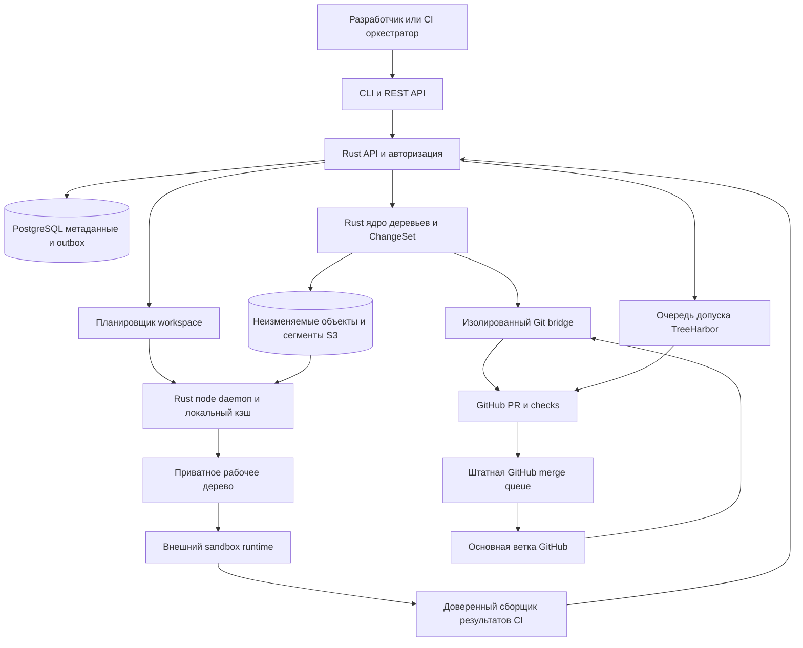

# TreeHarbor архитектура и контракт реализации

Дата: 21 октября 2026 года. Версия решения: 1.4. Статус: спецификация к реализации, продукт ещё не реализован; стандартная ELv2 принята, порог workspace отменён по ADR-005. Аудитория: агенты разработки, технический руководитель, инженеры платформы и безопасности.

TreeHarbor — развёртываемая у клиента Git-совместимая инфраструктура исходного кода для параллельных coding-агентов и CI. Собственное Rust-ядро хранит неизменяемые предложения изменений и доставляет рабочие деревья. В режиме Connected первого релиза GitHub остаётся источником истины для опубликованных веток. Самостоятельный режим с native-историей и main TreeHarbor проработан отдельно в [ADR-004](ADR-004-STANDALONE-MODE.md). Цель — уменьшить полную стоимость подготовки рабочих пространств и время принятия агентных изменений без обязательной миграции репозиториев для Connected.

Это действующая проектная основа. Она заменяет выбор Go, название AgentLane, бесплатный порог 300 000 и рекомендацию предпочесть CommitLatch из прежних материалов. Рабочее название TreeHarbor; публичная проверка GitHub выполнена 21.10.2026, регистрация названия не произведена.

Если не указано иначе, конкретные поля host-интеграции, API и жизненные циклы этого документа описывают Connected v0.1. ADR-004 задаёт явные дополнения для Standalone. Общие контракты долговечности, изоляции workspace, точных проверок и экспорта действуют в обоих режимах.

Связанные документы: [исследование и коммерческая модель](TREEHARBOR_RESEARCH.md), [план реализации и benchmark](TREEHARBOR_DELIVERY.md), [ADR-001: история лицензионного решения](ADR-001-LICENSE.md), [ADR-002: история сравнения лицензий](ADR-002-LICENSE-OPTIONS.md), [ADR-005: принятая ELv2 без порога](ADR-005-ELV2-ADOPTION.md), [ADR-003: облачные провайдеры и права на contributions](ADR-003-CLOUD-LICENSING-AND-CONTRIBUTIONS.md). Все показатели превосходства ниже — проверяемые цели, пока не результаты измерений.

## 1 Зафиксированные решения

| Решение | Контракт |
|---|---|
| Язык | Rust для сервера, ядра, node daemon, Git bridge и CLI. Python допустим для тестовых сценариев и SDK; второй серверный язык не вводить |
| Лицензия | Стандартная Elastic License 2.0 принята пользователем для Connected и Standalone; официальный текст не изменять. Решение — ADR-005 |
| Объём использования | Лицензионного порога workspace нет. Прежний порог отменён пользователем; не создавать счётчик лицензии, trial expiry или блокировки по объёму. Эксплуатационные лимиты ресурсов остаются отдельной настройкой |
| Срок и охват лицензии | Автоматического перехода на Apache-2.0 или другую открытую лицензию нет. Оригинальный код ядра, CLI, SDK, примеров, определений API и benchmark-инструментов следует одной модели. Лицензии стороннего кода сохраняются |
| Коммерческий managed service | Предусмотреть отдельное Provider/OEM-разрешение и достаточные права на оригинальный код и contributions по ADR-003. Это не расширяет MVP до облачного multi-tenant production и не разрешает поставщику доступ к исходникам клиентов |
| Развёртывание | В инфраструктуре клиента; без обязательного облака поставщика и передачи исходников поставщику |
| Первое применение | Внутренняя platform-команда с повторяющимися CI/агентными задачами, существенной стоимостью подготовки деревьев и 16–64 конкурентными задачами |
| Авторитет опубликованной ветки | GitHub в v0.1; TreeHarbor не создаёт второй независимо изменяемый main |
| Самостоятельный режим | Отдельный этап Standalone по ADR-004: общее ядро, собственная история/refs/очередь. Один authority на repository; миграция через freeze и epoch, без двусторонней записи. Не включать этот объём молча в v0.1 |
| Собственное ядро | Content-addressed storage, снимки деревьев, версии ChangeSet, доставка файлов и жизненный цикл workspace; обычный Git используется в адаптере совместимости |
| Первая интеграция | GitHub App, PR, checks и штатная GitHub merge queue; GitLab — отдельный последующий адаптер |
| ОС исполнения | Linux x86-64 для пилота. CLI Linux/macOS; ускорение через reflink только после проверки возможностей файловой системы |
| Sandbox | Внешний runtime клиента. Workspace и Rust не являются границей изоляции исполнения |
| Объём шести недель | Проверяемая alpha для контролируемого пилота, не эквивалент зрелости внутренней инфраструктуры Anthropic |

Значение «зафиксировано» означает: следующий агент реализует принятое решение. Rust и стандартная ELv2 зафиксированы пользователем; порог использования отменён согласно ADR-005. Изменение архитектуры требует отдельного ADR с причиной, последствиями и обновлением тестов. Новая явная инструкция пользователя имеет приоритет.

## 2 Что именно строим

Разделяем пять независимых объектов ответственности:

1. **Workspace** — набор файлов, точная исходная ревизия, режим материализации и аренда ресурсов.
2. **Runtime** — процессы агента/сборки, сеть, секреты и ограничения ресурсов. Управляется внешней системой.
3. **Source storage** — неизменяемые файлы, деревья и предложенные изменения. Не выполняет код репозитория.
4. **ChangeSet** — конкретная неизменяемая версия предложения от AgentRun. Её сохранение не означает разрешения на merge.
5. **Validation и IntegrationQueue** — свидетельства о проверенном результате и процесс допуска к включению в основную ветку.

В Connected v0.1 не создаём новый пользовательский формат репозитория, обязательную замену Git CLI, собственную систему issues/review, модель ИИ или гипервизор. Внутренний формат объектов сервиса допустим: он версионируется и имеет экспорт. Standalone — явный выбор собственной серверной истории и review/policy API по ADR-004, с сохранением Git-экспорта; такой выбор не навязывается пользователям Connected.

## 3 Сравнение архитектурных вариантов

| Вариант | Что получаем | Ограничение | Решение |
|---|---|---|---|
| Git worktree и кэш зеркала | Быстрый старт, стандартная история и инструменты | Материализация файлов на каждую задачу; общие Git-метаданные требуют защиты; нет самостоятельного жизненного цикла предложений | Обязательный baseline и режим совместимости |
| Собственный сервис деревьев и изменений с Git bridge | API без clone для части задач, повторное использование деревьев, собственные гарантии сохранения; постепенное внедрение | Дублирование части данных, стоимость bridge и поддержки совместимости | **Выбран** |
| Самостоятельная VCS с собственным main, историей, merge/rebase и Git-шлюзом | Независимый серверный source control | Миграция авторитета и дополнительная ответственность за историю; двусторонняя запись запрещена | Проработан Standalone в ADR-004; отдельный этап на общем ядре, не скрытая часть MVP |

Выбранный вариант содержит самостоятельное ядро, а не только обёртку над worktree. Агентный read/write путь работает с TreeHarbor API и его объектами. Git не вызывается для каждого чтения файла и для каждого промежуточного сохранения. Но импорт, Git-совместимый merge и публикация остаются за существующим Git. В v0.1 bridge всё ещё может хранить полное bare-зеркало репозитория; обещать отсутствие полной копии на сервере нельзя.

## 4 Схема системы



Код — модульный monolith с отдельными режимами запуска `server`, `worker`, `node`, `bridge`, а не набор независимых микросервисов. Node расположен рядом с исполнителями. Bridge с write credential отделён от процесса, принимающего недоверенные патчи. PostgreSQL и объектное хранилище — единственные обязательные внешние хранилища. Kafka, Redis, CockroachDB и Kubernetes не нужны для первой установки.

## 5 Предполагаемое преимущество и его механизм

| Механизм | За счёт чего должен выигрывать | Где не работает | Этап |
|---|---|---|---|
| План доставки для конкретной задачи | Выбирает необходимые пути, группирует чтения объектов и заранее готовит востребованные файлы | Неизвестные зависимости, полный обход репозитория | Явные профили в v0.1; автоматическая настройка после пилотов |
| Кэш готовых деревьев плюс reflink | Повторно использует уже распакованные файлы; новая задача не распаковывает всё заново | Холодный узел, неподдерживаемая ФС, большая доля изменений | v0.1, обычное копирование как fallback |
| Пакетная доставка объектов | Один запрос несёт много файлов; чтения соседних диапазонов объединяются | Случайный доступ по всему репозиторию, чрезмерное чтение лишних байтов | v0.1 |
| Изменения через API без локальной истории | Передаются изменённые байты и предикаты, а не новый clone/pack на каждую попытку | Агенту требуется полный локальный Git workflow | v0.1 плюс совместимый путь |
| Единый контекст workspace и проверки | Проверка запускается с известным деревом и средой; легче исключить дубли задач и объяснить устаревший CI | Недетерминированная сборка; изменение внешних зависимостей | v0.1, без повторного использования результата CI между ревизиями |
| Планирование по локальности кэша | Следующая задача попадает на узел с нужными файлами без бесконечного ожидания этого узла | Один перегруженный горячий узел; ограничения изоляции | Простая эвристика в v0.1 |
| Сохранение Git как основного процесса | Установка на часть задач; обычные PR; обратимый выход | Не снимает предел производительности GitHub main | v0.1 |

Это сочетание функций, не заявление о неизвестных конкурентам алгоритмах. Основное сравнение — с лучшим настроенным Git и доступными реализациями Scion на одинаковой нагрузке. У внутреннего Scion Anthropic нет доступного для нашего теста дистрибутива; превосходство над ним по скорости сейчас непроверяемо. Для внешнего покупателя проектируем более простой путь внедрения и иные правила допуска к merge. [Scion, опубликовано 13.10.2026, обновлено 15.10.2026](https://www.anthropic.com/research/redesigning-source-control).

## 6 Источники истины и границы транзакций

Таблица ниже описывает Connected v0.1. Для Standalone authoritative history/refs и факт включения принадлежат TreeHarbor по ADR-004; GitHub становится необязательным экспортом. Одновременно эти правила для одного репозитория не применяются.

| Данные | Источник истины | Восстановление |
|---|---|---|
| Опубликованные refs и обычная Git-история | GitHub | Повторный fetch; клиент продолжает обычный Git workflow |
| Принятый, но ещё не опубликованный ChangeSet | PostgreSQL запись плюс долговечные объекты TreeHarbor | Совместимый backup БД и объекта; экспорт в Git |
| Файловый snapshot | Неизменяемый root digest и достижимые объекты | Повторная материализация |
| Workspace процессы | Runtime клиента | Проверка фактического состояния; не доверять одному heartbeat |
| Статусы проверок | Неизменяемая запись Validation с идентичностью доверенного проверяющего | Повторная проверка при недостатке доказательств |
| Факт merge | Состояние GitHub, сверенное API | Webhook плюс периодическая сверка |
| Локальные кэши | Производные данные | Удаление и восстановление |

Нет распределённой атомарной транзакции между S3, PostgreSQL и GitHub. Используем upload-before-publish, транзакционный outbox, идемпотентные операции и сверку внешнего состояния. Система имеет доставку задач как минимум один раз; «ровно один раз» гарантируется только для определённых логических эффектов посредством уникальных ключей и проверки состояния.

## 7 Сущности и идентификаторы

| Сущность | Минимальные поля | Инвариант |
|---|---|---|
| Repository | tenant_id, repository_id, upstream_provider/id, object_format, default_ref, observed_commit, observed_at, policy_version | ID не переиспользуется после удаления; upstream URL задаёт администратор |
| Workspace | id, repository_id, base_commit, snapshot_id, profile_digest, mode, node_id, state, generation, lease_deadline | База — точный commit, не подвижное имя ветки |
| AgentRun | id, workspace_id, task_id, principal_id, agent_kind/version, runtime_id, started_at, stopped_at, state | Principal получен из авторизации, не из поля клиента |
| ChangeSet | id, version, base_commit, base_snapshot, operations_digest, result_snapshot, optional_git_commit, agent_run_id, state | Версия неизменяема; исправление создаёт новую версию |
| Validation | id, subject, subject_digest, check_name, check_definition_digest, environment_digest, policy_version, validator_id, run_id, result, evidence_uri | Результат относится только к указанному subject и контексту |
| IntegrationQueue | id, repository_id, target_ref, entries, policy_version, adapter | QueueEntry указывает ChangeSet version и точный PR head |
| QueueEntry | id, changeset_version, pr_number, head_sha, merge_group_sha, state, reason | Устаревший head не наследует разрешение предыдущего |
| Snapshot | id, root_object_digest, git_tree_oid, schema_version | SHA-256 внутреннего объекта и Git OID не смешиваются |
| Object / Segment | tenant, digest, type, length, state, storage_location, generation | Содержимое immutable; перемещение не меняет логическую идентичность |
| Lease / RootReference | holder, resource, generation, expiry или retention | Активный root защищает всё достижимое содержимое |
| Operation / Outbox | idempotency_key, request_digest, state, result, retry_at, lease_generation | Один ключ с другим содержимым — ошибка, не новая операция |

`ChangeSet.id + version` — идентичность предложения; `snapshot_id` — идентичность файлов; Git commit дополнительно включает родителей и метаданные. Одинаковое дерево не делает разные commits тождественными для проверки.

## 8 Хранение объектов

### 8.1 Логический формат

Внутренний digest: SHA-256 от domain separator, версии, типа, длины и канонически закодированного содержимого. Выбор SHA-256 упрощает аудит и совместимость инструментов; не является обещанием FIPS-сертификации. Формат имеет тестовые векторы. Порядок полей, числовое кодирование и сортировка имён фиксируются в отдельной спецификации до реализации.

Типы: `Blob`, `Directory`, `Snapshot`, `ChangeOperations`. Directory хранит отсортированные имена, тип, executable bit и digest дочернего объекта. Symlink хранится как данные ссылки; gitlink распознаётся, но native-режим v0.1 с submodule не поддерживается. Git OID хранится отдельно с указанием SHA-1/SHA-256; поддерживаемая матрица Git-host в v0.1 — SHA-1, SHA-256 repo получает явную ошибку до импортирования.

Пути транспортируются без потери байтов; JSON API поддерживает `path_b64` для не-UTF-8 имени. Запрещены NUL, выход за корень, служебные пути и неоднозначная нормализация. Для macOS/case-insensitive ФС конфликтующие имена отклоняются; Linux является эталонной платформой.

Изменение одного файла создаёт новый Blob и новые узлы его цепочки каталогов, повторно используя неизменившиеся поддеревья. Это не строго O(числа изменённых файлов): сериализация очень широкого каталога может зависеть от числа его записей. Шардированные directory nodes — последующая оптимизация, если профиль покажет этот предел.

### 8.2 Физическое хранение

Первый простой backend — один immutable объект на файл с локальным/S3 хранилищем. Это эталон корректности. Для производительного профиля alpha ядро поддерживает immutable сегмент с индексом и отдельно сжатыми frames: множество маленьких объектов загружаются одним PUT, крупный Blob может лежать отдельно. Начальные экспериментальные размеры: целевой сегмент 8 MiB, верхняя граница 64 MiB; значения выбираются benchmark, не входят навсегда в протокол.

Каталог сопоставляет `(tenant, object_digest)` с `(segment_id, generation, offset, compressed_length, logical_length)`. Клиент не делает SQL/RPC на каждый файл: сервер разрешает пакет объектов и отдаёт поток с проверяемыми frame digest. Планировщик объединяет близкие ranges, ограничивая overfetch. Целиком распаковывать огромный pack ради одного файла не требуется.

Сегмент — физическая упаковка, не новый Git pack и не новый формат репозитория. Распаковка, объекты и logical API одинаковы для loose и segmented backend. Совпавшие объекты дедуплицируются внутри tenant; кросс-клиентской дедупликации нет.

`object_store` предоставляет существующий Rust-интерфейс к объектным хранилищам и диапазонным чтениям; поддержка конкретного backend подтверждается conformance-тестами. Наличие S3 API само по себе не подтверждает нужные durability/conditional-write свойства. [Документация object_store, проверено 21.10.2026](https://docs.rs/object_store/latest/object_store/).

### 8.3 Протокол принятия изменения

1. Аутентифицировать principal; проверить repository и workspace generation, лимиты размера и write scopes.
2. Создать или вернуть Operation по idempotency key и digest запроса.
3. Зарезервировать upload session и объекты. Загрузить новый контент в уникальные immutable storage keys, проверить размер и digest. Для local backend требуется fsync файла и каталога; для object store — успешное завершение и проверка по контракту backend.
4. Вычислить result snapshot из base snapshot и file operations. Все `expected_before_digest` должны совпасть; отсутствующий файл не равен пустому файлу.
5. Короткой транзакцией PostgreSQL зафиксировать доступные объекты/ссылки, неизменяемую версию ChangeSet, root pin, результат Operation и outbox. Запись о готовом объекте не может предшествовать долговечным байтам.
6. После commit возвращать `accepted`. Отдельная операция экспортирует Git commit/PR. Сбой публикации не отменяет сохранённое предложение.

При одинаковых blob uploads два writer могут физически записать дубликаты; уникальная запись каталога выбирает одного владельца, лишняя запись остаётся orphan до очистки. Корректность важнее попытки устранить каждую конкурентную запись.

AWS S3 поддерживает conditional writes; для v0.1 authoritative mutable pointers всё равно живут в PostgreSQL, а не в перезаписываемом S3 JSON. [Условия AWS S3](https://docs.aws.amazon.com/us_en/AmazonS3/latest/userguide/conditional-writes.html).

## 9 Материализация и совместимость

### 9.1 Два явных режима

Здесь речь о формате файлового workspace, а не об authority mode Connected/Standalone из ADR-004. Эти две оси независимы.

**Native:** обычные файлы плюс metadata TreeHarbor; локальной `.git` нет. Для чтения файлов, редактирования и API-подачи изменений. Нельзя обещать работоспособность произвольного инструмента, который выполняет Git-команды.

**Git-compatible:** отдельный локальный Git repository на workspace. Refs, index, config и writable objects приватны. Разрешён общий только read-only object pool внутри того же tenant и с защитой от GC. Hooks и произвольные filters не наследуются. Полная история и редкие Git-функции могут потребовать дополнительный fetch; стоимость учитывается в benchmark. Git worktree используется как baseline/доверенная локальная опция, не как изоляция недоверенных агентов. [Общие метаданные worktree](https://git-scm.com/docs/git-worktree), [reference clone и риски заимствованных объектов](https://git-scm.com/docs/git-clone).

Native-mode v0.1 поддерживает обычные файлы, executable bit, безопасные symlinks и явные file operations. Repos с обязательными smudge/clean filters, LFS, submodules или зависимостью от нестандартной checkout-семантики направляются в совместимый профиль либо получают `UNSUPPORTED_REPOSITORY_FEATURE`. Не выдавать указатель LFS за содержимое файла.

### 9.2 План workspace

Ключ исходного дерева кэша: `(tenant, repository, snapshot, profile_digest, materializer_version, filesystem_semantics)`. Runtime image и dependency caches имеют отдельные ключи; они не подменяют идентичность source snapshot.

Профиль содержит path selections, обязательные root-файлы, режим полного/частичного дерева, допустимые инструменты и лимит расширения. Неизвестный инструмент по умолчанию получает полное дерево. Профиль не является security ACL: v0.1 read permission даётся на репозиторий; path-level confidentiality не обещается.

На узле строится immutable cache tree, проверяется, затем создаётся приватная копия через reflink, если он поддержан. Обычное копирование — обязательный fallback. Reflink не означает O(1) для дерева из миллиона файлов: обход directory entries остаётся. Writable hardlinks между workspace запрещены. Общие деревья не содержат секретов, runtime outputs и writable dependency caches.

Порядок планирования v0.1 детерминированный: сначала определить native/Git requirements, затем проверить допустимость sparse profile, затем искать готовое дерево, затем object cache и только после этого читать origin. При выборе node учитывать ожидаемое время его очереди вместе с объёмом недостающих байтов; вводится предельное время ожидания тёплого node, чтобы локальность не приводила к голоданию задач. Cache prewarm и работа пользователя имеют разные квоты. Одновременные запросы одного immutable дерева объединяются одной build operation; не запускают N распаковок.

Snapshot разрешается по точному commit. Для подвижного ref отдельный `resolve` возвращает commit, время наблюдения и режим свежести: `cached` либо `refresh`. Рабочее пространство после этого закрепляет возвращённый commit. Даже refresh означает состояние, наблюдавшееся при обращении к upstream, а не обещание неизменности main после ответа.

Проверка digest выполняется при получении immutable объекта и создании cache entry. Готовое cache tree принадлежит daemon и недоступно для записи агентам; используется атомарная публикация каталога после завершения. Периодический scrub выявляет повреждение хранения. Reflink ускоряет повторное использование уже проверенных файлов, но не превращает ФС в защищённое от аппаратного повреждения хранилище; corruption тесты должны проверять инвалидирование и повторную загрузку кэша.

OverlayFS с immutable lower и отдельным upper — оптимизация после пилота для совместимых runtime. Нижний слой нельзя менять под работающим mount. Она требует собственной проверки copy-up, whiteouts, удаления, rename и crash durability. FUSE/lazy POSIX filesystem не входит в v0.1. [Контракт OverlayFS, проверено 21.10.2026](https://www.kernel.org/doc/html/latest/filesystems/overlayfs.html).

### 9.3 Расширение sparse набора

`ensure(paths)` добавляет файлы той же базовой ревизии. Если путь уже изменён агентом, операция не перезаписывает его; возвращает конфликт или оставляет локальную версию согласно явному контракту. Полный переход выполняется через `ensure(full=true)`.

Без FUSE нельзя прозрачно перехватить каждый неудачный `open`, а успешная сборка может незаметно пропустить отсутствующие файлы через glob. Поэтому sparse допускается только для проверенного профиля. При известном missing-input сигнале задача останавливается, workspace расширяется, проверка запускается заново. Неизвестный сбой не классифицируется автоматически как missing input. [Различие partial clone и sparse checkout](https://git-scm.com/docs/partial-clone), [ограничения sparse index](https://git-scm.com/docs/git-sparse-checkout).

### 9.4 Согласованное получение изменений с диска

Watcher — подсказка для ускорения, не доказательство полного списка изменений. Перед `workspace seal` агент и все writer-процессы управляемого runtime останавливаются/замораживаются, создаётся отдельный стабильный snapshot, затем производится проверка файлов. Нельзя сканировать меняющуюся директорию и объявлять смесь состояний атомарным изменением.

Отсутствие пути вне sparse набора не означает удаление. Удаления и новые файлы подтверждаются явно; служебные файлы, секреты и build outputs исключены правилами. Для неуправляемых внешних writer гарантия согласованного seal не предоставляется: запрос отклоняется до остановки writers. API-подача immutable blobs может обходиться без файлового seal.

## 10 Жизненный цикл и аренды

```text
Workspace: REQUESTED -> PREPARING -> READY -> IN_USE -> SEALING -> SEALED
                             \-> FAILED          \-> FAILED
READY / SEALED / IN_USE -> DRAINING -> DELETING -> DELETED
потеря узла -> LOST -> восстановление из сохранённого snapshot или FAILED

AgentRun: CREATED -> RUNNING -> STOPPING -> SUCCEEDED | FAILED | CANCELLED | LOST
ChangeSet: RECEIVING -> ACCEPTED -> EXPORTING -> EXPORTED | EXPORT_FAILED
QueueEntry: REQUESTED -> WAITING_POLICY -> ADMITTED -> HOST_QUEUED
            -> VALIDATING -> MERGED | CONFLICTED | CHECKS_FAILED | STALE | CANCELLED
```

`ACCEPTED` описывает сохранение, `ADMITTED` — допуск, `MERGED` — подтверждённое включение. Один зелёный статус не заменяет эти разные события.

Каждое назначение worker имеет generation/fencing token. Все изменения состояния сравнивают актуальную generation в БД. Просроченный worker не может отправить финальный статус или обновить workspace. Продление lease — отдельная операция; TTL не является гарантией прекращения процесса.

При удалении ставится tombstone, новые задачи запрещаются. Для активной задачи по умолчанию возвращается drain operation. Runtime подтверждает остановку, затем освобождаются mounts и pins. Если node недоступен, ресурс карантинируется; живые данные не удаляются по одному только отсутствию heartbeat. Принудительное удаление означает явную отмену и подтверждённое прекращение исполнения, а не `rm -rf` под работающим агентом.

## 11 Проверки и включение в main

Validation связывается с точным commit или snapshot и контекстом: тип проверки, определение workflow, image digest, toolchain, lockfiles/dependency identity, платформа, policy version и доверенный validator. Для проверок с внешними изменяемыми зависимостями одного хеша дерева недостаточно.

В v0.1 **не переносим зелёный результат между разными commits даже при равном дереве**. Старый результат остаётся в аудите, но перестаёт удовлетворять новому кандидату. Проверку может зарегистрировать только CI collector, назначенный для конкретного validation run; агент не имеет права сам назначить себе `passed`.

GitHub App экспортирует отдельную ветку ChangeSet/версии и PR. Update PR требует согласования актуального head; неизвестное внешнее изменение ветки не перезаписывается. Очередь TreeHarbor управляет допуском, отменой и видимостью, а финальный порядок merge и требуемые `merge_group` checks — штатная очередь GitHub. Это не две независимо записывающие main очереди.

На `merge_group` проверяется именно выданный GitHub SHA, содержащий текущую базу и предшествующие PR. При смене группы результаты старой группы не переносятся. Не обещаем, что final merge commit всегда имеет тот же SHA: адаптер хранит связь group/head/final commit и сверяет итоговое дерево и предусмотренную host семантику. Branch protections не обходятся; ошибки API или недоступный CI блокируют допуск. [GitHub merge queue и событие merge_group, проверено 21.10.2026](https://docs.github.com/en/repositories/configuring-branches-and-merges-in-your-repository/configuring-pull-request-merges/managing-a-merge-queue).

Для первого частного пилота требуется GitHub Enterprise Cloud с доступной merge queue. В репозитории без неё v0.1 создаёт PR и отслеживает результат ручного процесса, но не обещает тот же автоматический контракт интеграции. Native merge queue TreeHarbor и GitLab merge trains — отдельные последующие работы.

Native queue, review и CI без GitHub теперь имеют отдельный контракт в ADR-004. Указанные здесь GitHub PR/head/group поля относятся к host adapter; они не становятся обязательными полями native кандидата.

Непересекающиеся пути используются для эвристики очереди, но не доказывают семантическую независимость. Два изменения одного файла могут объединяться без текстового конфликта; всё равно нужен CI объединённого кандидата. Внешний resolver, включая LLM, может предложить новую версию ChangeSet, но не имеет полномочий отменять проверки.

## 12 Десять обязательных сценариев

| Сценарий | Поведение | Обязательная проверка реализации |
|---|---|---|
| Два агента меняют один файл | Каждое предложение связано со своей base; Git bridge строит трёхсторонний результат. Конфликт возвращается структурированно; никакого last-write-wins | Одинаковые строки дают конфликт; непересекающиеся строки проходят объединённый CI |
| Текстового конфликта нет, смысл несовместим | Проверяется объединённый результат; при падении integration test очередь блокируется. Все семантические конфликты не обнаруживаем | Переименование контракта в одном файле и несовместимое использование в другом |
| Main изменился после запуска | ChangeSet сохраняется относительно исходной базы; admission/host queue создаёт новый кандидат | Новый main не подменяет base в сохранённом предложении |
| Проверки прошли старую версию | Eligibility пересчитывается для нового subject; старые Validation не удаляются | Изменение одного байта, workflow или среды снимает действительность старого результата для нового кандидата |
| Worker упал при отправке | До commit может остаться orphan upload; после commit повтор возвращает сохранённый результат | Kill до/после upload и до/после DB commit |
| Запрос доставлен повторно | Тот же ключ и тело возвращают тот же результат; другой digest тела даёт 409 | Один логический результат операции и один ChangeSet/PR при N повторениях |
| Force-push или опасная Git-команда агента | Writable Git state приватен; агент не имеет upstream write token. Изменение локального HEAD не меняет server base | Агент не может перезаписать чужую ветку, общий cache или main |
| Удаление пересеклось с задачей | Drain, fencing и подтверждение остановки; данные удерживаются до завершения | Stale worker после удаления отвергается; mount не удалён преждевременно |
| GC пересёкся с workspace | Активные root pins удерживают объектный граф и Git base; GC не удаляет доступные объекты | Конкурентный submit/pin/read/delete плюс потеря node |
| Сборке не хватает sparse файлов | Контролируемое расширение/полное дерево и новая проверка; неизвестный профиль изначально full | Отсутствующий root config, glob и generated input не дают ложного успешного результата |

## 13 Очистка данных и защита от гонок

**V0.1:** root references и ребра immutable DAG учитываются в PostgreSQL. При публикации родителя он может ссылаться только на LIVE children, которые в той же операции получают долговечные ссылки. Создание дерева снизу вверх исключает циклы. Удаление последней ссылки делает объект кандидатом на очистку после grace period; refcount — ускоряющее поле, восстановимое из таблиц roots/edges.

Writer и GC используют одинаковые блокировки состояния объекта. GC переводит объект с нулём ссылок и без upload/read reservations в RETIRING; новый writer не может сослаться на RETIRING generation. Он ждёт удаления или повторно загружает байты в новую storage generation и заново публикует объект. Удаление родителя освобождает его child edges транзакционно и запускает каскад очередью. Не использовать только возраст объекта или S3 LIST как доказательство недостижимости.

Активный workspace/validation/queue entry держит root pin, защищающий все descendants. Pending uploads имеют reservations. Retention опубликованного/отклонённого ChangeSet явно задана; audit metadata может сохраняться дольше файлов. В initial defaults: активные предложения защищены, завершённые версии 30 дней, orphan upload 24 часа; это настраиваемая политика и источник storage cost.

Перед read root pin создаётся атомарно с проверкой LIVE state; нельзя сначала получить locator, а затем защищать объект. Блокировки нескольких объектов берутся в едином порядке digest, транзакции ограничены по размеру и имеют retry при deadlock. Публикация крупного дерева идёт снизу вверх с upload reservations, а финальный root становится видимым одной короткой транзакцией. Полный список файлов workspace не вставляется в PostgreSQL заново на каждую задачу. Метаданные GC всё равно имеют цену, и размер edges/catalog включается в benchmark.

Для segmented backend физический сегмент удаляется, только когда все его объекты мертвы и нет reader leases. В v0.1 partially-live сегменты не перепаковываются: метрика dead-bytes показывает amplification. Compaction после пилотов копирует live objects, проверяет digests, атомарно заменяет locators и сохраняет старую generation до окончания readers. Если сборка мусора или расчёт ссылок неуверенны, удаление останавливается, поднимается alert; запись можно ограничить квотой.

Простой reference model для GC и конкурентных публикаций обязателен до включения автоматического удаления. Refcount reconciliation, dry-run и recovery drill входят в готовность пилота. GC не объявляется решённым одним наличием TTL.

Git bridge отдельно держит приватные retention refs для активных base/export commits и выполняет maintenance только под своим протоколом. Агент не получает доступ к этим refs. Правила Git GC и TreeHarbor GC не смешиваются.

## 14 Сбой внешней публикации

Outbox job содержит детерминированное имя ветки и ожидаемый Git commit. При неизвестном результате push worker читает remote ref: совпал commit — эффект уже выполнен; другая ревизия — конфликт, не force overwrite. По PR ищет соответствие head branch и repository, учитывая открытые и закрытые PR; потерянный ответ не создаёт второй PR. Временная неопределённость GitHub API переводит операцию в reconciliation, а не в бесконечный create.

GitHub webhooks проверяются по подписи, дедуплицируются и считаются сигналом для чтения актуального состояния. Потеря или перестановка webhook покрывается периодической сверкой. Ошибка GitHub не делает принятый ChangeSet потерянным.

Внутренние задачи берутся из PostgreSQL с короткими транзакциями и lease; `SKIP LOCKED` применяется только к распределению работы, не к чтению согласованного состояния очереди или политики. [PostgreSQL SELECT](https://www.postgresql.org/docs/current/sql-select.html).

## 15 Безопасность и полномочия

| Граница | Гарантия продукта | Требование внешней системы |
|---|---|---|
| Файлы | Приватные writable paths; проверка путей и digest; общие immutable cache деревья | Kernel/mount isolation, запрет выхода из sandbox |
| Процессы | Runtime identity, lease, lifecycle adapter, отказ в доступе после fencing | Изоляция процессов, seccomp/VM, kill, CPU/RAM/PID/time quotas |
| Сеть | Scope сервисного токена, отсутствие upstream credentials у агента | Egress policy, DNS/прокси, запрет metadata endpoints |
| Git metadata | Приватные refs/index/config; read-only pool с pin | FS permissions и отдельные UID/VM |
| Проверки | Exact subject, trusted validator identity, неизменяемая запись | Корректная CI конфигурация и секреты, доверенная runner image |
| Клиенты | Tenant в каждом ключе, запросе и auth check; отдельная установка по умолчанию | Для жёсткой многопользовательской изоляции — отдельные узлы/VM и storage policies |
| Публикация | Отдельный bridge, repository-scoped краткоживущий GitHub token | GitHub branch protection, review и очередь |

V0.1 не является публичным shared multi-tenant SaaS. Для недоверенного кода пилот использует отдельные VM/runtime клиента; контейнер в общем ядре без дополнительной модели угроз не объявляется эквивалентом VM. Runtime может быть заменён без изменения Source API. Anthropic sandbox-runtime — отдельный preview-компонент ограничений процессов, а не Scion и не готовая гарантия нашей изоляции. [Anthropic srt](https://github.com/anthropics/sandbox-runtime).

Hooks репозитория, global Git config, credential helpers, external diff и произвольные filters в bridge отключены. Git commands формируются без shell interpolation, с whitelist аргументов и URL. Read-only import credentials не дают прав публикации. GitHub App для публикации требует минимальных прав contents/PR и при необходимости checks на выбранные repos; административные права настройки branch protection выдаёт отдельно владелец репозитория, не агент.

Untrusted PR workflows не получают production secrets. Изменение workflow/policy требует review соответствующего владельца. Новый код может изменить тесты, поэтому успешный запуск произвольной команды агента не равен доверенной проверке.

Лимиты выставляются до загрузки: размер patch/blob, число файлов, глубина путей, decompressed bytes, длительность RPC, число concurrent uploads, workspace disk/inodes, CPU/RAM/time runtime. Ограничение памяти в Rust обеспечивается bounded queues/backpressure, а не обещанием языка.

## 16 Наблюдаемость и эксплуатация

Обязательные metrics: workspace prepare/ready/useful-action p50/p95; bytes origin→service→node; cache hit по байтам и запросам; CPU/RSS всех компонентов; object-store requests; reused/copied bytes; file count; Git bridge queue age; admission/merge latency; stale validations; idempotency hits; retry count; GC backlog/dead bytes; leaked leases; runtime termination latency. Метрики потребления ресурсов служат эксплуатации и benchmark, а не лицензионному учёту.

Trace связывает repository, task, workspace, AgentRun, ChangeSet version, Validation, QueueEntry и host PR. IDs допустимы в traces/logs с контролем доступа; не размещать высококардинальные IDs в Prometheus labels. Логи не содержат исходники, diff и секреты по умолчанию.

При отказе PostgreSQL новые authoritative изменения не принимаются. Уже материализованные задачи могут продолжаться в пределах runtime policy, но новые permissions/публикации не выдаются. При отказе object store кэшированные чтения допускаются, новые изменения подтверждаются только после durable upload. При полном отказе TreeHarbor клиент возвращается к обычному Git/CI.

Гарантия `accepted` переживает перезапуск процесса при сохранных durable storage и PostgreSQL с synchronous_commit. Она не означает RPO=0 при потере зоны или асинхронном failover БД. RPO/RTO устанавливаются конфигурацией клиента и подтверждаются restore drill. Для alpha не обещаем коммерческий uptime SLA. Backup должен содержать БД и все объекты её roots; restore включает проверку достижимости и digest.

Backup является отдельным держателем roots. На согласованной границе metadata snapshot фиксируется набор backup references; они удерживаются до окончания копирования и в течение срока хранения backup. Если используется PostgreSQL PITR, политика хранения объектов обязана покрывать весь обещанный интервал восстановления и соответствующие поколения locators. Простой ежедневный dump БД плюс независимый lifecycle удаления S3 этому контракту не соответствует. При restore сеть публикации GitHub изначально отключена: сначала reconcile внешнего состояния, затем возобновление outbox, чтобы старый backup не породил повторные публикации.

## 17 API и CLI

Это проектный контракт, не работающие сегодня команды. REST JSON для управления и потоковые HTTP endpoints для blobs/batches; OpenAPI публикуется вместе с версией. gRPC не обязателен в v0.1. Транспорт можно заменить за адаптером без изменения сущностей.

```text
POST   /v1/repositories/{repo}/workspaces
GET    /v1/operations/{operation}
GET    /v1/workspaces/{workspace}
GET    /v1/workspaces/{workspace}/files?path=src/main.rs
POST   /v1/workspaces/{workspace}/ensure
POST   /v1/workspaces/{workspace}/seal
POST   /v1/uploads
PUT    /v1/uploads/{upload}/parts/{part}
POST   /v1/changesets
POST   /v1/validations                         # только trusted validator
POST   /v1/queues/{queue}/entries
GET    /v1/queue-entries/{entry}
DELETE /v1/workspaces/{workspace}             # асинхронный drain
```

Создать от точной ревизии:

```json
{
  "base_commit": "0123456789abcdef0123456789abcdef01234567",
  "task_id": "migration-42",
  "mode": "native",
  "profile": {"paths": ["services/payments", "libs/contracts"], "include_root_files": true},
  "runtime_binding": "customer-runner-pool-1",
  "ttl_seconds": 3600
}
```

Заголовок `Idempotency-Key: workspace-migration-42`; ответ `202 {operation_id, workspace_id}`. READY означает проверенное дерево и закреплённые ресурсы, а не только поставленную задачу. Files API возвращает bytes с digest и идентичностью snapshot; не отдаёт случайный текущий `main`.

Подать изменение:

```json
{
  "workspace_id": "ws_42",
  "workspace_generation": 3,
  "agent_run_id": "run_A",
  "base_commit": "0123456789abcdef0123456789abcdef01234567",
  "operations": [
    {"op": "put", "path": "services/payments/limit.rs", "expected_before_digest": "sha256:OLD", "blob_digest": "sha256:NEW", "mode": "100644"},
    {"op": "delete", "path": "services/payments/obsolete.rs", "expected_before_digest": "sha256:OLD2"}
  ]
}
```

Значения `OLD/NEW` — обозначения digest для примера, не валидные хеши. Blob загружается предварительно. Текстовый patch может быть удобным входом CLI, но сервер преобразует его в exact file operations с предикатами. Rename в v0.1 — delete+put; эвристика rename не влияет на сохранность.

Результат проверки:

```json
{
  "validation_run_id": "vr_17",
  "subject": {"kind": "git_commit", "sha": "89abcdef0123456789abcdef0123456789abcdef01"},
  "snapshot_digest": "sha256:TREE",
  "check_name": "integration",
  "check_definition_digest": "sha256:WORKFLOW",
  "environment_digest": "sha256:ENVIRONMENT",
  "policy_version": 4,
  "result": "passed",
  "evidence_uri": "ci://trusted-run/17"
}
```

Principal доверенного collector берётся из токена, а не из тела запроса. Запись не разрешает merge, если текущий queue subject другой.

```text
treeharbor workspace create --repo payments --base <full-commit> --profile payments --json
treeharbor files get --workspace ws_42 services/payments/limit.rs
treeharbor workspace ensure ws_42 --path libs/shared
treeharbor workspace seal ws_42
treeharbor changes submit --workspace ws_42 --run run_A --operations changes.json
treeharbor validation report --run vr_17 --result result.json
treeharbor queue enqueue cs_42 --version 1 --target main
treeharbor queue status qe_42 --watch
treeharbor workspace delete ws_42 --drain
treeharbor export cs_42 --version 1 --format git-bundle --output change.bundle
```

Коды: 409 `BASE_MISMATCH/IDEMPOTENCY_MISMATCH/STALE_GENERATION`; 422 `UNSUPPORTED_FEATURE/INVALID_PATH`; 403 scope/permission; 429 quota/rate limit с retry metadata; 503 transient backend. Операции с неизвестным исходом читаются по Operation ID, а не автоматически пересоздаются с новым ключом.

## 18 Стек и структура будущего репозитория

Rust stable с зафиксированным toolchain и Cargo.lock. Tokio для async I/O; axum для REST; reqwest для клиента; serde для API; SQLx/PostgreSQL для metadata; object_store для S3/локального backend; zstd для frames; clap для CLI; tracing/OpenTelemetry и Prometheus для диагностики. Версии фиксируются при реализации после проверки совместимости и лицензий. Storage/wire codecs имеют собственные golden vectors, а не зависят от случайного порядка serde map.

Git bridge использует изолированный системный Git с зафиксированной поддерживаемой версией: batch plumbing для чтения, `merge-tree --write-tree` для совместимого merge. Он не требует writable checkout для самого вычисления merge, но не заменяет проверки полученного результата. Git process pool ограничен; процесс на каждый файл запрещён. `gix` может применяться для разобранных immutable объектов только после conformance-сравнения, не как молчаливая замена всех Git semantics. [Git merge-tree](https://git-scm.com/docs/git-merge-tree).

```text
crates/
  core/                 # identities, snapshots, file operations, invariants
  storage/              # objects, segments, catalog, GC
  metadata/             # PostgreSQL schema, transactions, outbox, leases
  materializer/         # native tree, reflink/copy, verification
  node/                 # cache, workspace lifecycle, runtime adapter
  git-bridge/           # Git import/export, conflict analysis
  integrations-github/  # App, PR, checks, queue, webhooks
  server/               # authenticated API, bounded job workers
  cli/                  # treeharbor
  protocol/             # API definitions and client types; same project license
tests/                  # conformance, faults, compatibility, adversarial
benchmarks/             # runners under project license; fixtures retain upstream licenses
deploy/                 # compose first; systemd/Helm later
docs/                   # architecture, ADR, API, operations, limitations
sdk/                    # generated clients after API stabilizes
```

Это схема будущих файлов; настоящий репозиторий и код в текущем задании не создаются.

Для Standalone предусмотрены дополнительные Rust-модули history/native-integration/review-policy и интерфейс MergeEngine из ADR-004. Общие storage/materializer/validation не форкаются. Git bridge остаётся обязательным вычислителем merge в Connected v0.1 и допустим на ступени S1; ступень S2 должна работать без него в native-пути.

## 19 Обратимое внедрение

Ниже описан выход из Connected. Передача источника истины в Standalone и обратная миграция имеют отдельный freeze/fencing протокол в ADR-004; они не эквивалентны отзыву GitHub App.

Сначала подключение read-only и измерение нескольких CI jobs. Затем workspace API, после этого приём ChangeSet без публикации, затем GitHub App для веток/PR, и только после проверки policy — admission в merge queue. Шаги имеют отдельные permissions; подключение чтения не даёт права записи.

Отключение: остановить новые admissions, дождаться/отменить текущие операции, экспортировать нужные непубликованные версии в Git bundles, сверить PR, отозвать App и credentials, вернуть CI обычный checkout. Сохранить audit/export по retention, после этого очистить node mounts и хранилища. Уже опубликованные ветки/PR и main остаются в GitHub. Экспорт — обязательная функция бесплатной версии; лицензия не блокирует чтение и вывоз данных.

Экспорт явно различает self-contained bundle с необходимой историей и incremental bundle с перечисленными Git prerequisites. По умолчанию для аварийного выхода выбирается self-contained режим; его стоимость на большом репозитории показывается заранее. Ни один режим не требует TreeHarbor для чтения уже экспортированного Git bundle; для incremental bundle требуется обычный Git repository с указанной базой.

## 20 Условия заявления о превосходстве

До benchmark допустимо говорить «спроектировано для снижения затрат». После benchmark — только конкретный workload, baseline, hardware, cache state и диапазон результатов. Не использовать «быстрее Anthropic», «нет семантических конфликтов», «нулевая стоимость checkout» и «не требуется обслуживание хранилища» как безусловные обещания.

Успех архитектуры: на выбранных реальных workload при 16/64 конкурентных задачах минимум 2× улучшение p95 подготовки либо минимум 30% снижение полной инфраструктурной стоимости относительно лучшего Git baseline; отдельно подтверждена корректность и не ухудшен time-to-first-useful-action. Это gate пилота, а не готовый результат. По доступным конкурентам требуется измерить тот же сценарий, и проигрыш в части матрицы публикуется.

Если git-ai/OpenCSGs или другой доступный engine проходит наш контракт и даёт такой же результат с меньшей стоимостью разработки, следующий ADR должен рассмотреть его как backend с сохранением исходной лицензии. Выигрывать бизнесом можно качеством внедрения и эксплуатации; собственный движок оправдан измеримым отличием, не самим фактом его написания.
